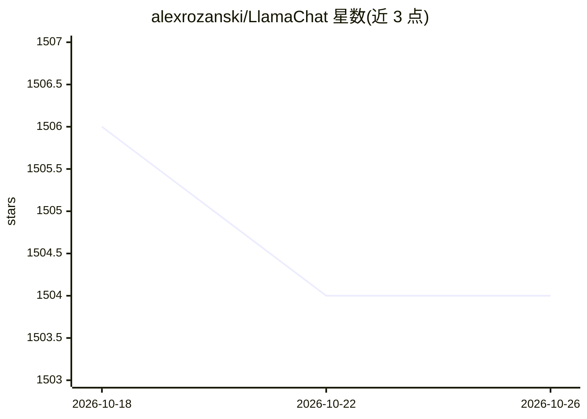

# alexrozanski/LlamaChat

⭐ 1,504 · Swift · MIT · 推送 2026-06-17 · [GitHub](https://github.com/alexrozanski/LlamaChat) · [官网](https://llamachat.app) · 个人维护

**在 Mac 上本地对话 LLaMA/Alpaca/GPT4All 模型的原生应用**

使用 Swift/SwiftUI 编写的 macOS 原生聊天应用，基于 llama.cpp 与 llama.swift 在本地运行推理，支持 LLaMA、Alpaca、GPT4All 模型。可导入 .pth PyTorch 原始检查点并在应用内转换为 .ggml 格式，或直接使用 .ggml 文件；聊天历史在应用内持久化，可查看当前模型上下文。要求 macOS 13 Ventura、Intel 或 Apple Silicon 处理器；不附带模型文件，需自行获取。提供 .dmg 直接下载与源码构建两种方式，源码构建需 Release 配置。

## 筛选速览

| 维度 | 判定 | 备注 |
|---|---|---|
| AI 角色 | `ai-native` | 本体是模型或模型工具 |
| 许可风险 | `permissive` | MIT |
| 部署形态 | `desktop` | 安装包/桌面程序 |
| 模型依赖 | — | README 未给出锁定关系 |
| 硬件要求 | — | 无带数字的原话,不猜 |
| 安装摩擦 | `low` | 无编译、无系统依赖或容器化 |
| 成熟度 | — | 结构信号不足 |

## 能力要点

- 支持 LLaMA/Alpaca/GPT4All 模型本地运行
- 应用内将 .pth 检查点转换为 .ggml 格式
- 聊天历史持久化与模型上下文查看
- 基于 llama.cpp/llama.swift 的 Swift/SwiftUI 原生应用

## 适用场景

- 在 Mac 上离线与本地 LLaMA 系模型对话
- 将 PyTorch 检查点转换为 ggml 格式并直接使用
- 管理多模型会话并保留聊天历史

## 场景标签

`聊天机器人` · 领域:对话与助手

## 证据(README 行号)

> L6: **LlamaChat** is a macOS app that allows you to chat with LLaMA, Alpaca and GPT4All models all running locally on yo
> L31: - **Flexible Model Formats:** LLamaChat is built on top of llama.cpp and llama.swift. The app supports adding LLaMA

## 星数曲线

2026-10-18 1,506 → 2026-10-26 1,504（-2）

---
*卡片 v1 · prompt 1.4 · 生成 2026-10-21 · 置信度 high · 依据 README sha `ac7da2a7e2c6` · [字段定义](../../DATASET.md)*
