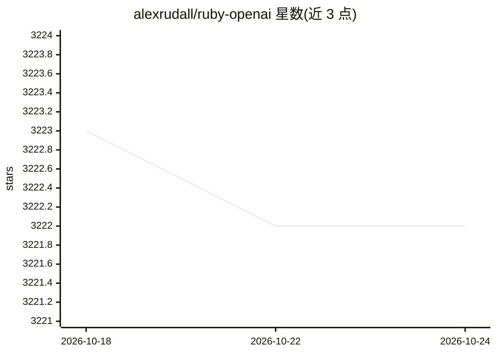

# alexrudall/ruby-openai

⭐ 3,223 · Ruby · MIT · 推送 2026-05-01 · [GitHub](https://github.com/alexrudall/ruby-openai) · [官网](https://insertrobot.com) · 个人维护

**Ruby 的 OpenAI API 客户端库：聊天/Responses/嵌入等接口封装**

面向 Ruby/Rails 开发者的 OpenAI API 官方风格封装 gem，覆盖 Chat（含流式、Vision、JSON Mode）、Responses API（有状态多轮、工具调用）、Completions、Embeddings、Batches、模型管理与 token 估算。客户端可配置 access_token、超时、自定义 base URI 与 Faraday 中间件；除 OpenAI 本体外，给出 Azure、Deepseek、Ollama、Groq 等 OpenAI 兼容端点的接入示例。以 gem 形式安装，需自备 API key。

## 筛选速览

| 维度 | 判定 | 备注 |
|---|---|---|
| AI 角色 | `ai-ecosystem` | LLM/agent 周边工具 |
| 许可风险 | `permissive` | MIT |
| 部署形态 | `None` |  |
| 模型依赖 | local-ok | 支持本地模型 |
| 硬件要求 | — | 无带数字的原话,不猜 |
| 安装摩擦 | `low` | 无编译、无系统依赖或容器化 |
| 成熟度 | — | 结构信号不足 |

## 能力要点

- 封装 Chat 流式输出与 Responses API（有状态对话、工具调用）
- 支持 Vision、JSON Mode、Embeddings、Batches 等端点
- 可自定义 base URI，示例覆盖 Azure/Deepseek/Ollama/Groq 兼容端点
- 支持 Faraday 中间件与按客户端附加请求头

## 适用场景

- 在 Rails 应用中接入 OpenAI 对话与流式输出
- 通过 Responses API 构建有状态多轮与工具调用
- 用 Ollama 等本地兼容端点跑开源模型
- 批量异步处理 Chat 与 Embedding 请求

## 场景标签

`模型网关` · 领域:Agent 开发

## 证据(README 行号)

> L7: Use the OpenAI API with Ruby! 🤖❤️
> L266: response = client.chat(

## 星数曲线

2026-10-18 3,223 → 2026-10-24 3,222（-1）

---
*卡片 v1 · prompt 1.4 · 生成 2026-10-20 · 置信度 high · 依据 README sha `030fc4f94d9c` · [字段定义](../../DATASET.md)*
