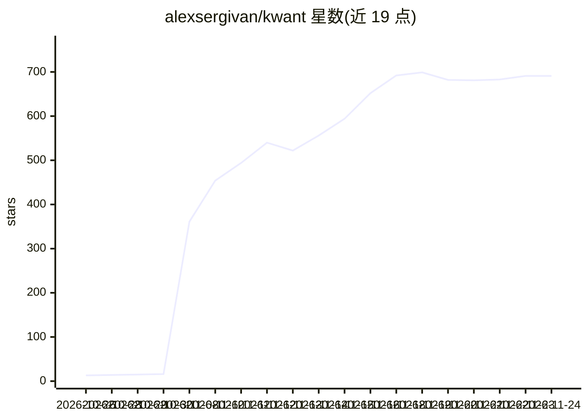

# alexsergivan/kwant

⭐ 701 · Rust · AGPL-3.0 · 推送 2026-11-24 · [GitHub](https://github.com/alexsergivan/kwant) · [官网](https://kwant.si) · 个人维护

**自托管二进制的 AI 机器人团队协作运行环境**

kwant 以单个自托管二进制形式运行（Rust + 内嵌 React Web 应用），提供多机器人团队协作：消息按 @mention 在机器人间交接、按计划或用户离开时执行任务，工作以卡片形式呈现在 Mission board 上，任务仅在系统自身运行检查后标记为 Verified。支持按空间隔离机器人与账户、Inbox 审阅与批准/回滚、跨模型二次检查、机器人浏览器页面隔离与月度预算。运行依赖用户已有的 Claude、Codex 或 Grok CLI，或自备 API 密钥。提供 macOS/Linux 安装包与服务器部署方式。

## 筛选速览

| 维度 | 判定 | 备注 |
|---|---|---|
| AI 角色 | `ai-ecosystem` | LLM/agent 周边工具 |
| 许可风险 | `dual` | AGPL-3.0 |
| 部署形态 | `desktop` | 安装包/桌面程序 |
| 模型依赖 | — | README 未给出锁定关系 |
| 硬件要求 | — | 无带数字的原话,不猜 |
| 安装摩擦 | `low` | 无编译、无系统依赖或容器化 |
| 成熟度 | — | 结构信号不足 |

## 能力要点

- 多机器人团队：@mention 交接、定时例程、按空间隔离
- 任务由系统自身运行检查后标记 Verified，支持 Inbox 审阅/批准/回滚
- 跨模型二次检查与变异测试式验证（高风险工作）
- 机器人独立浏览器页面、月度 token/美元预算限制

## 适用场景

- 让多个 AI 机器人分工协作完成开发与审查任务
- 定时或无人值守时执行自动化工作流
- 在自托管服务器上集中管理多个 AI 账户与连接

## 场景标签

`多智能体` `工作流自动化` · 领域:Agent 开发

## 证据(README 行号)

> L27: kwant gives you a team of bots that share chats, hand work to each other with an @mention and get it done on their 
> L29: It's written in Rust (Tokio, Axum, SQLite) with a React web app embedded in the binary.
> L1: kwant: a pixel-art night town where a team of bots hand work to each other

## 星数曲线

2026-10-26 13 → 2026-11-24 691（+678）

---
*卡片 v1 · prompt 1.4 · 生成 2026-11-24 · 置信度 low · 依据 README sha `09befb3da808` · [字段定义](../../DATASET.md)*
