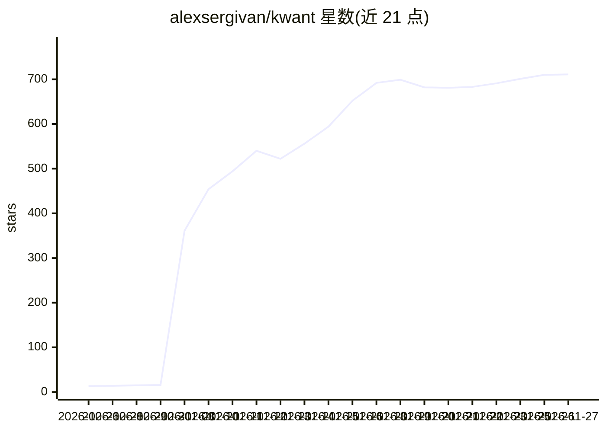

# alexsergivan/kwant

⭐ 711 · Rust · AGPL-3.0 · 推送 2026-11-26 · [GitHub](https://github.com/alexsergivan/kwant) · [官网](https://kwant.si) · 个人维护

**自托管的多 bot 协作团队工具：分工、互检、审批与定时任务**

以单个自托管二进制交付的多 bot 协作平台：bot 之间通过 @mention 交接任务，按日程或无人值守时自主执行；任务以卡片形式呈现在 Mission board 上，只有 kwant 自身运行检查通过才标记 Verified。支持按工作/生活划分独立 space、Inbox 风险分级审批、跨模型二次检查、浏览器实时观看与点选指引、Dev desk 的 worktree 与 PR 回流。Rust+Tokio+SQLite 编写，内嵌 React 前端，可复用已有的 Claude/Codex/Grok CLI 或自有 API key。

## 筛选速览

| 维度 | 判定 | 备注 |
|---|---|---|
| AI 角色 | `ai-native` | 本体是模型或模型工具 |
| 许可风险 | `dual` | AGPL-3.0 |
| 部署形态 | `desktop` | 安装包/桌面程序 |
| 模型依赖 | — | README 未给出锁定关系 |
| 硬件要求 | — | 无带数字的原话,不猜 |
| 安装摩擦 | `low` | 无编译、无系统依赖或容器化 |
| 成熟度 | — | 结构信号不足 |

## 能力要点

- bot 团队 @mention 交接任务，回复说明分派理由
- 任务需 kwant 自身运行检查通过才标记 Verified，Inbox 支持批量审批与回滚
- 跨模型在干净副本上二次检查，高风险任务做变异测试
- 每 bot 独立浏览器页面、月度 token/美元预算与 Composio/MCP 工具接入

## 适用场景

- 让一组 bot 分工完成并互相检查自动化任务
- 管理多个 AI 账号与 space，区分工作与个人用途
- 开发场景下给 bot 分配 worktree 跟踪 PR 与 CI 结果
- 通过 Telegram/手机审批 bot 的敏感操作

## 场景标签

`多智能体` `工作流自动化` · 领域:Agent 开发

## 证据(README 行号)

> L3:  Your own team of AI bots that check each other’s work before saying “done”.
> L27: kwant gives you a team of bots that share chats, hand work to each other with an @mention and get it done on their 

## 星数曲线

2026-10-26 13 → 2026-11-27 711（+698）

---
*卡片 v1 · prompt 1.4 · 生成 2026-11-27 · 置信度 mid · 依据 README sha `167fa0046cfe` · [字段定义](../../DATASET.md)*
