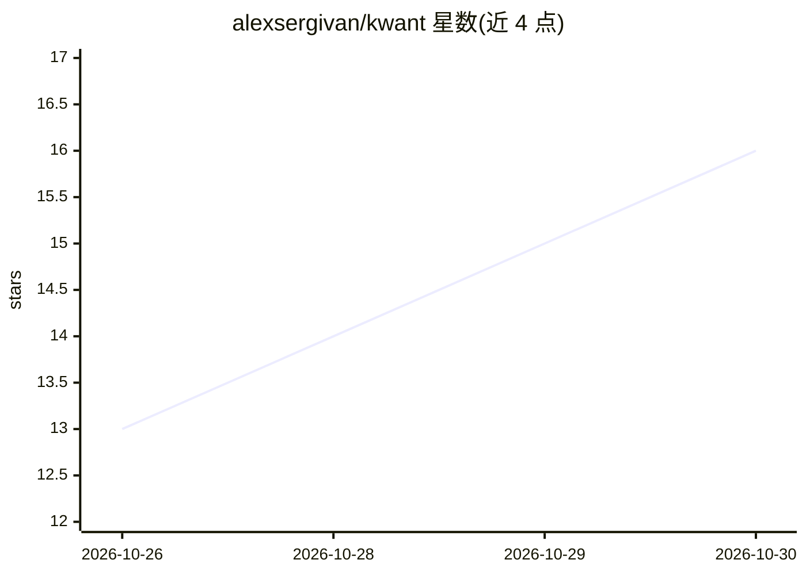

# alexsergivan/kwant

⭐ 16 · Rust · AGPL-3.0 · 推送 2026-10-29 · [GitHub](https://github.com/alexsergivan/kwant) · [官网](https://kwant.si) · 个人维护

**自托管单二进制的 AI 机器人团队平台：多账号、协作与定时任务**

用 Rust 编写、内嵌 React 前端的单体二进制，运行一组有角色与模型的 AI bot：bot 之间通过 @mention 交接工作，Laya 路由选择由谁、用哪个模型回答；支持多空间隔离、每引擎多账号（Claude/Codex/Grok CLI 登录或 Anthropic/OpenAI/xAI API key）自动切换、定时例程、危险步骤审批卡、读取 IMAP/GitHub issue 的 loose ends 整理与 MCP 工具服务器。面向想在笔记本或 VPS 上自托管 bot 团队的个人用户；首次启动需下载约 420 MB 的 Laya 模型（--no-laya 可关闭）。

## 筛选速览

| 维度 | 判定 | 备注 |
|---|---|---|
| AI 角色 | `ai-native` | 本体是模型或模型工具 |
| 许可风险 | `viral` | AGPL-3.0 |
| 部署形态 | `desktop` | 安装包/桌面程序 |
| 模型依赖 | locked-api |  |
| 硬件要求 | — | 无带数字的原话,不猜 |
| 安装摩擦 | `low` | 无编译、无系统依赖或容器化 |
| 成熟度 | — | 结构信号不足 |

## 能力要点

- bot 间 @mention 交接工作，Laya 路由分配回答者与模型
- 每引擎多账号配置，额度用尽自动切到下一账号
- 危险步骤（git push、网络调用等）审批卡：Allow once / Always allow / Deny
- L1 可安装为 PWA 并通过加密 Web Push 推送审批通知

## 适用场景

- 在自托管环境里运行有分工的 AI bot 团队替我干活
- 把工作、副业、家庭分成独立空间，各有 bot 与账号
- 让 bot 定时跑例程，回来后看 While you were away 汇总

## 场景标签

`多智能体` `AI 助手` · 领域:Agent 开发

## 证据(README 行号)

> L9: kwant gives you a team of bots that share chats, hand work to each other with an @mention and get it done on their o
> L19: - **A team, not a chat tab.** Each bot has its own role, voice ("soul") and model. Bots @mention each other to hand
> L21: - **Every account you have.** Several accounts per engine: Claude, Codex or Grok CLI logins, Anthropic, OpenAI or x

## 星数曲线

2026-10-26 13 → 2026-10-30 16（+3）

---
*卡片 v1 · prompt 1.4 · 生成 2026-10-30 · 置信度 mid · 依据 README sha `92b9b64c0d7c` · [字段定义](../../DATASET.md)*
