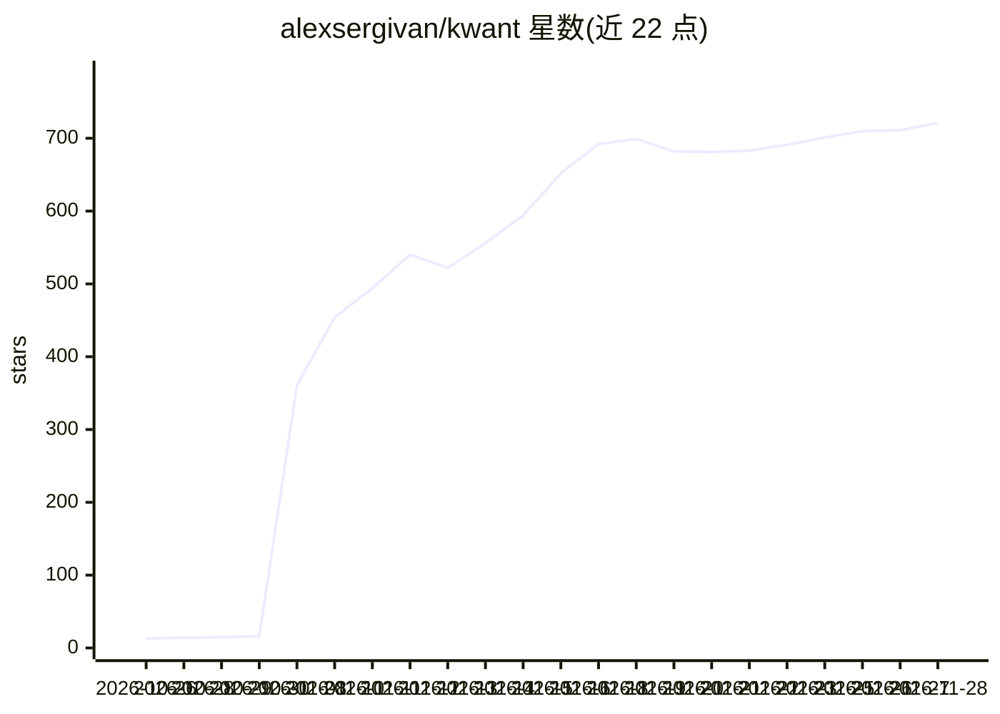

# alexsergivan/kwant

⭐ 721 · Rust · AGPL-3.0 · 推送 2026-11-27 · [GitHub](https://github.com/alexsergivan/kwant) · [官网](https://kwant.si) · 个人维护

**自托管的 AI bot 团队应用：分配协作互检工作**

kwant 以单个自托管二进制（Rust + 内嵌 React）提供一支 AI 机器人团队：bot 间通过 @mention 交接工作，任务以卡片形式出现在 Mission 看板，须由系统自身运行检查后才标记 Verified，支持另一模型的交叉复核、回滚与审批流程。支持工作/家庭独立 spaces、例行计划任务、Telegram 审批、浏览器自动化与 Composio/MCP 工具接入，可用已有 Claude、Codex 或 Grok CLI 或自有 API key 驱动。提供 macOS、Linux 安装包与 Docker 部署。

## 筛选速览

| 维度 | 判定 | 备注 |
|---|---|---|
| AI 角色 | `ai-native` | 本体是模型或模型工具 |
| 许可风险 | `dual` | AGPL-3.0 |
| 部署形态 | `desktop` | 安装包/桌面程序 |
| 模型依赖 | — | README 未给出锁定关系 |
| 硬件要求 | — | 无带数字的原话,不猜 |
| 安装摩擦 | `low` | 无编译、无系统依赖或容器化 |
| 成熟度 | — | 结构信号不足 |

## 能力要点

- bot 团队通过 @mention 交接并互相检查工作
- 任务须由 kwant 自身运行检查通过才标记 Verified，支持跨模型第二检查与回滚
- 独立 spaces、例行计划、Telegram 审批与每 bot 月度预算
- 接入已有 Claude/Codex/Grok CLI 或自有 API key，内置 Composio/MCP 工具发现

## 适用场景

- 搭建一组互相核查产出的 AI bot 团队协作完成任务
- 用手机通过 Telegram 审批或继续 bot 的工作
- 为重复工作设定定时例行任务，离开时由 bot 完成

## 场景标签

`多智能体` `浏览器自动化` · 领域:Agent 开发

## 证据(README 行号)

> L28: kwant gives you a team of bots that share chats, hand work to each other with an @mention and get it done on their 
> L30: It's written in Rust (Tokio, Axum, SQLite) with a React web app embedded in the binary.

## 星数曲线

2026-10-26 13 → 2026-11-28 721（+708）

---
*卡片 v1 · prompt 1.4 · 生成 2026-11-28 · 置信度 mid · 依据 README sha `63f0eb933621` · [字段定义](../../DATASET.md)*
