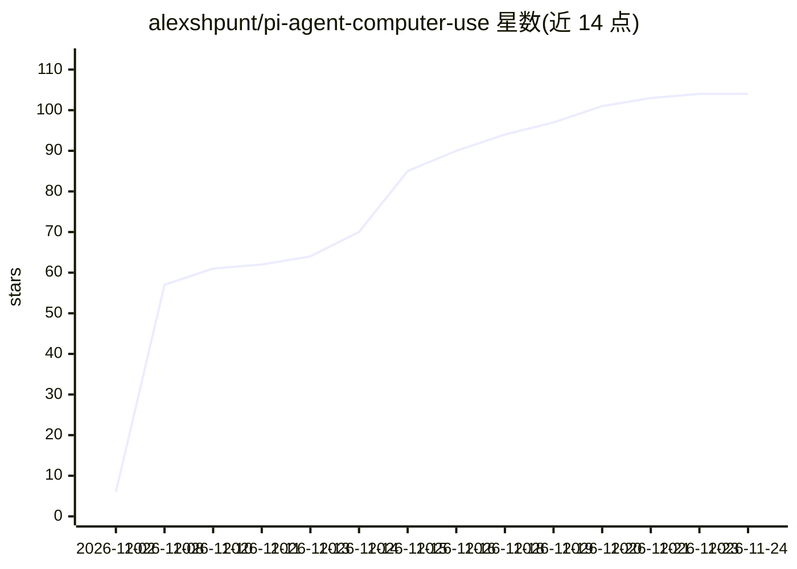

# alexshpunt/pi-agent-computer-use

⭐ 104 · TypeScript · MIT · 推送 2026-11-22 · [GitHub](https://github.com/alexshpunt/pi-agent-computer-use) · [官网](https://pi.dev/packages/pi-agent-computer-use) · 个人维护

**让 Pi 编码 agent 操作 Windows 应用与浏览器的扩展包**

Pi Agent IDE 的扩展包，为 Pi 编码 agent 提供统一计算机操作接口：读取窗口的 UI Automation 树、元素提示与截图，通过 computer_click/computer_type 等类型化工具执行真实键鼠输入与 UIA 调用；网页部分经 Playwright 处理（可附加到 Chrome/Edge/Electron/WebView2 应用）。原生捕获与输入来自其 Cua Driver 分支。支持 YOLO 与 Safe 两种权限模式、Windows Sandbox 隔离会话、SSH 控制远程 Windows 机器、三连 Escape 紧急停止。每个动作返回 delivered/refused/unknown 回执。平台限定 Windows 与 WSL，以 npm 包分发。

## 筛选速览

| 维度 | 判定 | 备注 |
|---|---|---|
| AI 角色 | `ai-ecosystem` | LLM/agent 周边工具 |
| 许可风险 | `permissive` | MIT |
| 部署形态 | `None` |  |
| 模型依赖 | — | README 未给出锁定关系 |
| 硬件要求 | — | 无带数字的原话,不猜 |
| 安装摩擦 | `low` | 无编译、无系统依赖或容器化 |
| 成熟度 | — | 结构信号不足 |

## 能力要点

- 读取窗口 UI Automation 树、元素提示与截图，输入始终指向最新所见元素
- 真实键鼠输入（含笔压、按键保持、输入时间线）与 UIA 后台调用
- Playwright 网页操作，可附加到 Chrome/Edge 及 Electron/CEF/WebView2 应用
- Windows Sandbox、隔离用户会话与 SSH 远程机器控制

## 适用场景

- 让编码 agent 替我操作桌面应用，如填表单、看设置窗口
- 在 GIMP 等画图软件中让 agent 按参考图作画
- 让 agent 在浏览器中完成网页操作与检查
- 在沙箱或隔离会话中运行 agent 以避免干扰本人桌面

## 场景标签

`GUI 自动化` `浏览器自动化` · 领域:效率与自动化

## 证据(README 行号)

> L5:  Lets your Pi agent use Windows apps and browsers: it reads the window, clicks, types, draws and checks what happene
> L37: Pi Agent Computer Use gives the Pi coding agent one interface for every Windows app, browsers included. The agent f

## 星数曲线

2026-11-02 6 → 2026-11-24 104（+98）

---
*卡片 v1 · prompt 1.4 · 生成 2026-11-17 · 置信度 high · 依据 README sha `52e4e6e62648` · [字段定义](../../DATASET.md)*
