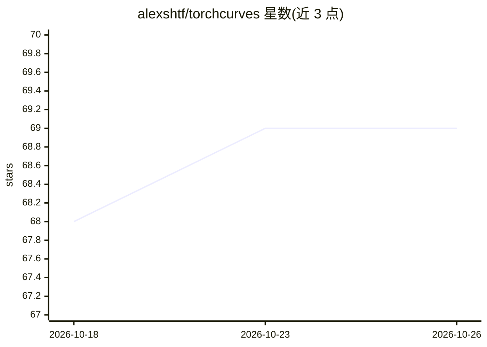

# alexshtf/torchcurves

⭐ 69 · Python · Apache-2.0 · 推送 2026-10-18 · [GitHub](https://github.com/alexshtf/torchcurves) · [官网](https://torchcurves.readthedocs.io/en/stable/) · 个人维护

**PyTorch 可微分参数曲线库：用于 KAN、连续嵌入与形状约束建模**

面向 PyTorch 用户的可微参数曲线模块库：提供系数可学习的 B 样条曲线、Legendre 多项式曲线等，通过自定义 autograd 函数保证梯度传播，向量化操作支持批量与多曲线求值。支持三类用法：连续嵌入层、单调函数等形状受限模型（如广告竞价胜率建模）、以及基于 B 样条或 Legendre 多项式基的 Kolmogorov-Arnold 网络（KAN）。系数可由外部网络生成后在 forward 时传入。要求 Python 3.12+ 与 PyTorch 2.9+，以 pip 包形式提供。

## 筛选速览

| 维度 | 判定 | 备注 |
|---|---|---|
| AI 角色 | `ai-native` | 本体是模型或模型工具 |
| 许可风险 | `permissive` | Apache-2.0 |
| 部署形态 | `library` | 以包/库形式分发 |
| 模型依赖 | — | README 未给出锁定关系 |
| 硬件要求 | — | 无带数字的原话,不猜 |
| 安装摩擦 | `medium` | 含编译或系统依赖之一 |
| 成熟度 | — | 结构信号不足 |

## 能力要点

- 自定义 autograd 函数保证曲线求值的梯度传播，向量化支持批量多曲线
- 提供 B 样条、Legendre 多项式等可学习参数曲线及多种输入映射预设
- 支持用 B 样条构造 KAN、单调形状约束模型与连续嵌入
- Legendre 曲线支持梯度检查点以时间换内存

## 适用场景

- 在 PyTorch 模型中用可学习 B 样条/Legendre 曲线构造 KAN 层
- 将类别或数值特征映射为连续可微嵌入
- 构建带单调性等形状约束的函数（如广告竞价胜率预测）

## 场景标签

 · 领域:机器学习/深度学习库

## 证据(README 行号)

> L8: A PyTorch module for _vectorized_ and _differentiable_ parametric curves with learnable coefficients, such as a B-sp
> L89: ## Use case 3 - Kolmogorov-Arnold networks

## 星数曲线

2026-10-18 68 → 2026-10-26 69（+1）

---
*卡片 v1 · prompt 1.4 · 生成 2026-10-24 · 置信度 high · 依据 README sha `70f4c4f901c7` · [字段定义](../../DATASET.md)*
