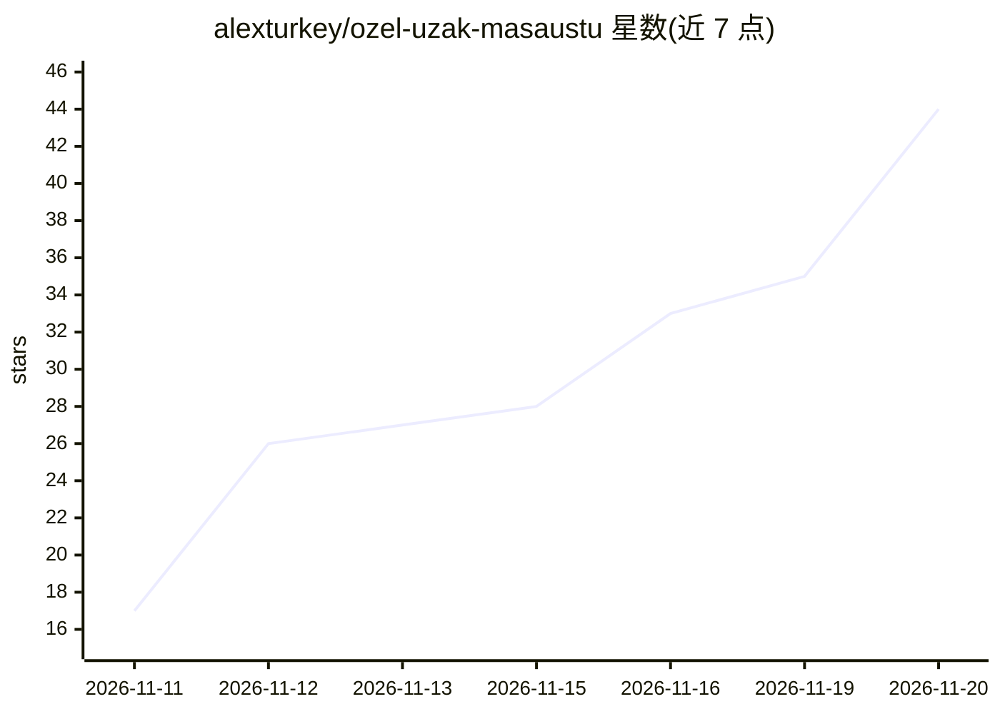

# alexturkey/ozel-uzak-masaustu

⭐ 44 · PowerShell · MIT · 推送 2026-11-13 · [GitHub](https://github.com/alexturkey/ozel-uzak-masaustu) · 个人维护

**面向非开发者的私有远程桌面分步设置指南，由 AI 代理执行**

土耳其语的图文指南加辅助 PowerShell 脚本：指导用户在两台 Windows 10/11 设备间通过 Tailscale 组网、Pro 用系统远程桌面、Home 用 RustDesk，实现免开端口免公网 IP 的私有远程桌面。指南写给非程序员使用：用户将仓库交给自己的 AI 代理（Claude Code、Codex、Cursor），代理按 AGENTS.md 规则逐步执行并请求用户批准，进度写入 DURUM.md。脚本默认 DryRun，改防火墙的脚本需管理员权限；限制包括仅支持 Windows 10/11、硬 NAT 下走中继、Windows Pro/RDP 分支未实测。

## 筛选速览

| 维度 | 判定 | 备注 |
|---|---|---|
| AI 角色 | `ai-knowledge` | 知识聚合/清单类 |
| 许可风险 | `permissive` | MIT |
| 部署形态 | `None` |  |
| 模型依赖 | locked-api |  |
| 硬件要求 | — | 无带数字的原话,不猜 |
| 安装摩擦 | `low` | 无编译、无系统依赖或容器化 |
| 成熟度 | `idea` | |

## 能力要点

- Tailscale + RustDesk/系统远程桌面实现免开端口私有远程桌面
- 指南由用户的 AI 代理逐步执行，每步有操作/证据/回滚记录
- 辅助脚本默认 DryRun，需 -Uygula 才实际执行，含自动回滚定时器
- 双机代理可通过 Tailscale Taildrop 互发消息与文件并用 sha256 校验

## 适用场景

- 在两台家庭电脑间搭建免开端口的远程桌面
- 让 Claude Code 等 AI 代理按指南代替我完成网络与防火墙配置
- 出门在外用手机或笔记本访问家中电脑

## 场景标签

`教程课程` · 领域:学习与行业

## 证据(README 行号)

> L6: Yazılımcı olmayanlar için yazıldı: rehberi kendi yapay zekâ ajanına (Claude Code, Cursor, Codex vb.) verirsin, ajan 
> L35: 2. Ajanını **A'da**, o klasörde aç. Claude Code kuralları (`AGENTS.md`) kendiliğinden yükledi (denendi); Codex ve C

## 星数曲线

2026-11-11 17 → 2026-11-20 44（+27）

---
*卡片 v1 · prompt 1.4 · 生成 2026-11-18 · 置信度 high · 依据 README sha `d0bfe183ea73` · [字段定义](../../DATASET.md)*
