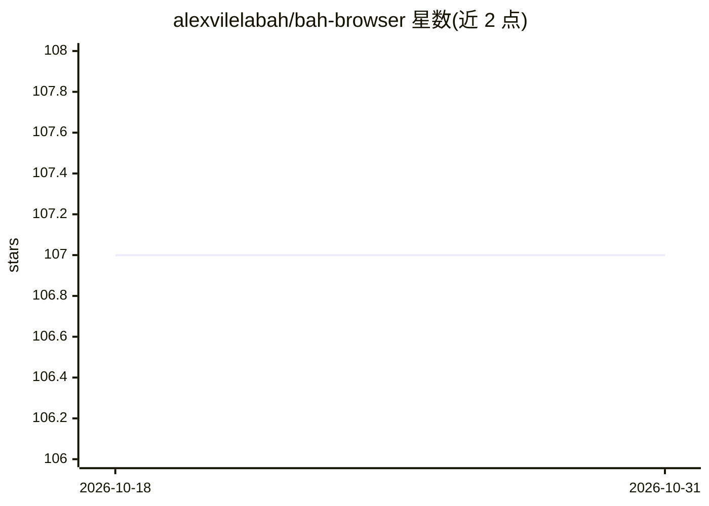

# alexvilelabah/bah-browser

⭐ 107 · TypeScript · MIT · 推送 2026-10-18 · [GitHub](https://github.com/alexvilelabah/bah-browser) · 个人维护

**开源 AI 浏览器：自然语言命令让 AI 代你操作网页**

基于 Electron + React + TypeScript 的浏览器应用，内置 AI Agent 面板：用户输入自然语言命令，AI 通过读取 DOM、编号元素与 OCR 感知页面，以 ReAct 循环调用工具（点击、输入、导航、标签管理等，每命令 25 步上限），用 Chromium 真实鼠标事件操作网页。AI 后端支持 DeepSeek、Mistral、NVIDIA NIM 云端 API 或本地 Ollama；图像生成无需 key。支付、删除等敏感操作前会请求用户确认。面向普通用户，提供 Windows 安装包与 macOS dmg。

## 筛选速览

| 维度 | 判定 | 备注 |
|---|---|---|
| AI 角色 | `ai-native` | 本体是模型或模型工具 |
| 许可风险 | `permissive` | MIT |
| 部署形态 | `desktop` | 安装包/桌面程序 |
| 模型依赖 | local-ok | 支持本地模型 |
| 硬件要求 | — | 无带数字的原话,不猜 |
| 安装摩擦 | `medium` | 含编译或系统依赖之一 |
| 成熟度 | `idea` | |

## 能力要点

- ReAct 循环 Agent：读取 DOM/OCR，通过结构化工具操作网页
- 支持 DeepSeek/Mistral/NVIDIA NIM 云端或本地 Ollama，图像生成免 key
- 真实 Chromium 鼠标事件（sendInputEvent），兼容 React/Vue 等站点
- 支付、删除、输入卡号等敏感操作前强制用户确认，单命令 25 步上限

## 适用场景

- 用自然语言让 AI 代为完成网页操作（如收邮件、删垃圾邮件）
- 每个标签页独立 AI 对话，结合 YouTube 字幕讨论视频
- 选择本地 Ollama 实现 100% 离线的 AI 浏览器体验

## 场景标签

`浏览器自动化` `聊天机器人` · 领域:效率与自动化

## 证据(README 行号)

> L5:  AI browser — type in plain language, and the AI autonomously operates the web for you.
> L55: - **AGENT panel** on the side: type a command → the AI decides step by step until it's done

## 星数曲线

2026-10-18 107 → 2026-10-31 107（+0）

---
*卡片 v1 · prompt 1.4 · 生成 2026-10-23 · 置信度 high · 依据 README sha `22a313d69259` · [字段定义](../../DATASET.md)*
