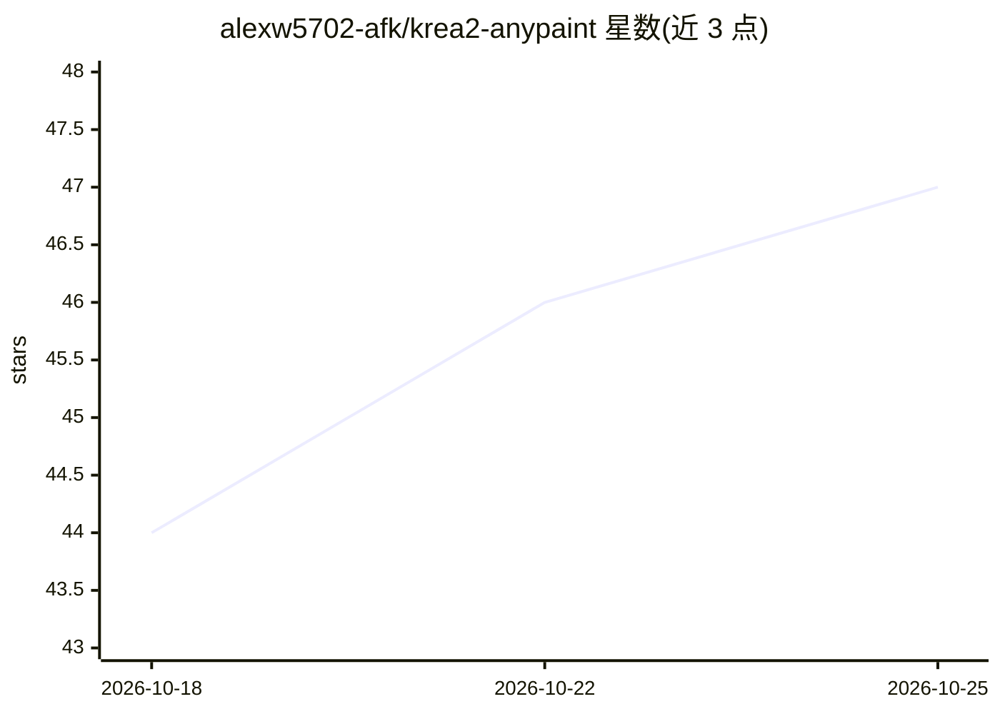

# alexw5702-afk/krea2-anypaint

⭐ 47 · Python · MIT · 推送 2026-08-03 · [GitHub](https://github.com/alexw5702-afk/krea2-anypaint) · [官网](https://huggingface.co/yijunwang2/krea2-anypaint) · 个人维护

**Krea 2 AnyPaint 的 ComfyUI 节点包：任意遮罩重绘与外绘**

为 ComfyUI 提供的原生节点包，接入 yijunwang2/krea2-anypaint 适配器，使 Krea 2 Turbo 支持任意遮罩 inpainting、outpainting 与混合图像编辑。含三个节点：Prepare（生成 384px 语义参考、画布与遮罩）、Encode（输出含 noise_mask 的 LATENT）、Model Patch（注册参考注意力并预计算 K/V 缓存）。安装需 git clone 至 custom_nodes，并自备 Krea 2 Turbo 模型、Qwen3-VL 文本编码器、VAE 与 AnyPaint LoRA 等文件；量化运行时输出可能与 BF16 示例存在像素级差异。

## 筛选速览

| 维度 | 判定 | 备注 |
|---|---|---|
| AI 角色 | `ai-native` | 本体是模型或模型工具 |
| 许可风险 | `permissive` | MIT |
| 部署形态 | `None` |  |
| 模型依赖 | — | README 未给出锁定关系 |
| 硬件要求 | — | 无带数字的原话,不猜 |
| 安装摩擦 | `low` | 无编译、无系统依赖或容器化 |
| 成熟度 | — | 结构信号不足 |

## 能力要点

- 任意遮罩 inpainting/outpainting 可在同一请求中组合，白区生成、黑区保留
- 三个节点：Prepare/Encode/Model Patch，含参考注意力与 K/V 缓存预计算
- 经三份 Comfy-Org 模型文件端到端验证，与 Diffusers 参考管线逐步骤匹配
- 节点代码 MIT 许可，LoRA 受 Krea 2 Community License 约束

## 适用场景

- 在 ComfyUI 中对照片做局部重绘或改色
- 水彩、3D 等风格图像向任意方向外扩绘制
- 人物边界补全、窗景替换等多区域混合编辑

## 场景标签

`图像生成` · 领域:内容生成

## 证据(README 行号)

> L3: Native ComfyUI nodes for the
> L5: functional adapter. AnyPaint adds arbitrary-mask **inpainting**, **outpainting**,
> L6: and mixed **image editing** to Krea 2 Turbo.

## 星数曲线

2026-10-18 44 → 2026-10-25 47（+3）

---
*卡片 v1 · prompt 1.4 · 生成 2026-10-25 · 置信度 high · 依据 README sha `27d0dbe332a2` · [字段定义](../../DATASET.md)*
