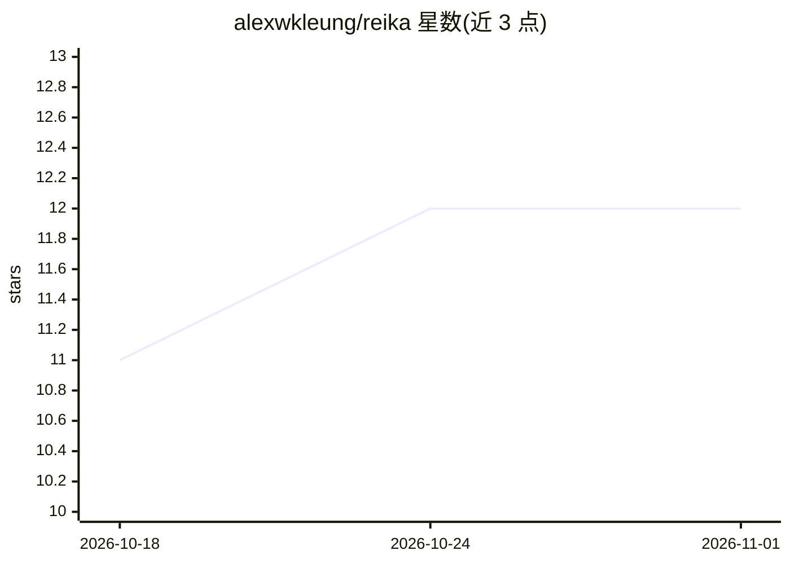

# alexwkleung/reika

⭐ 12 · TypeScript · Apache-2.0 · 推送 2026-10-31 · [GitHub](https://github.com/alexwkleung/reika) · [官网](https://reikacode.com) · 个人维护 · 中文 README

**面向小型本地模型的编码 agent CLI（优先本地运行时）**

Reika 是一个终端编码 agent CLI，面向本地与托管模型，设计上优先适配 8B–35B 的小型本地模型（Q2–Q4 量化、16–32k 上下文）。核心机制包括：append-only 请求保住 prompt cache、旧工具输出折叠为摘要、循环/螺旋检测与升级干预、编辑前强制读取、TypeScript 基线类型检查、macOS 上的内核沙箱执行 shell 命令。通过 OpenAI 兼容端点连接 llama.cpp、MLX、vLLM 或云 API；支持 MCP 扩展、无遥测。项目 pre-1.0，命令与配置可能变化；macOS 为主平台，Linux 无 shell 沙箱，Windows 仅可能在 WSL2 下运行。

## 筛选速览

| 维度 | 判定 | 备注 |
|---|---|---|
| AI 角色 | `ai-ecosystem` | LLM/agent 周边工具 |
| 许可风险 | `permissive` | Apache-2.0 |
| 部署形态 | `library` | 以包/库形式分发 |
| 模型依赖 | local-ok | 支持本地模型 |
| 硬件要求 | — | 无带数字的原话,不猜 |
| 安装摩擦 | `low` | 无编译、无系统依赖或容器化 |
| 成熟度 | `idea` | |

## 能力要点

- 面向小型本地模型的上下文管理：折叠摘要、append-only、自写 findings note
- 循环/螺旋检测与升级干预（nudge→pinned ledger→tool withdrawal→honest stop）
- macOS 内核沙箱：模型选择的 shell 命令写限项目目录、禁网络
- 7 种模式（agent/plan/vibe/grind/chat 等）与 Stdio MCP 扩展

## 适用场景

- 在本地小型模型上跑多文件编码任务，控制上下文消耗
- 配合 llama.cpp/vLLM 本地服务端做离线编码辅助
- 用只读 plan 模式先产出编号计划再执行实现

## 场景标签

`编码 Agent` · 领域:编码与开发

## 证据(README 行号)

> L3:  A coding agent CLI for local and hosted models,
> L16: Reika is a coding agent CLI for local and hosted models. It was designed around small local models first (8B–35B, o
> L46: - An OpenAI-compatible model server: llama.cpp, MLX, vLLM, or a cloud API.

## 星数曲线

2026-10-18 11 → 2026-11-01 12（+1）

---
*卡片 v1 · prompt 1.4 · 生成 2026-11-01 · 置信度 high · 依据 README sha `d96c8d596de3` · [字段定义](../../DATASET.md)*
