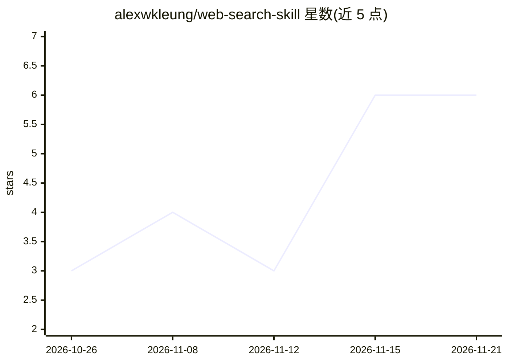

# alexwkleung/web-search-skill

⭐ 6 · Python · Apache-2.0 · 推送 2026-10-24 · [GitHub](https://github.com/alexwkleung/web-search-skill) · 个人维护

**为编码 agent 提供浏览器级网页搜索与页面读取的技能**

以技能目录形式安装到 agent 的 skills 路径，通过 Chrome CDP 驱动真实浏览器执行搜索（走 Brave 结果页）与页面读取（defuddle 转 markdown）。无需 API key、无需自托管，脚本 web.sh 在 Node 22+ 与 Python 3.9+ 两种运行时间自动选择，可用环境变量强制指定。浏览器以独立 profile 最小化运行以减少 bot 检查；遇到检查时弹窗人工解决一次。macOS 为主，Linux 未充分测试，Windows 暂不支持。

## 筛选速览

| 维度 | 判定 | 备注 |
|---|---|---|
| AI 角色 | `ai-ecosystem` | LLM/agent 周边工具 |
| 许可风险 | `permissive` | Apache-2.0 |
| 部署形态 | `None` |  |
| 模型依赖 | — | README 未给出锁定关系 |
| 硬件要求 | — | 无带数字的原话,不猜 |
| 安装摩擦 | `low` | 无编译、无系统依赖或容器化 |
| 成熟度 | `idea` | |

## 能力要点

- 通过 Chrome DevTools Protocol 驱动真实浏览器搜索与读取页面，无需 API key
- search 走 Brave 结果页，read 用页面内运行的 defuddle 生成 markdown
- Node 22+ 与 Python 3.9+ 双运行时，web.sh 自动选择、可环境变量覆盖
- 通过 git clone 安装到 agent skills 目录即用，无额外依赖安装

## 适用场景

- 为没有内置网页搜索的编码 agent（尤其是本地模型配置）补充搜索能力
- 读取反爬或阻止纯抓取的网页并转为 markdown 供 agent 使用
- 在 Claude Code、OpenCode、pi 等 agent 中按需触发网页检索

## 场景标签

`网页抓取` `浏览器自动化` · 领域:效率与自动化

## 证据(README 行号)

> L3: A web search and page-reading skill for coding agents. It drives a real Chrome over the DevTools protocol instead of
> L16: Clone it into a folder named `web-search` in a directory your agent loads skills from:
> L54: It's most useful in agents with no web search of their own, which is most local-model setups. Where the agent has a

## 星数曲线

2026-10-26 3 → 2026-11-21 6（+3）

---
*卡片 v1 · prompt 1.4 · 生成 2026-11-20 · 置信度 high · 依据 README sha `25c63a2ed776` · [字段定义](../../DATASET.md)*
