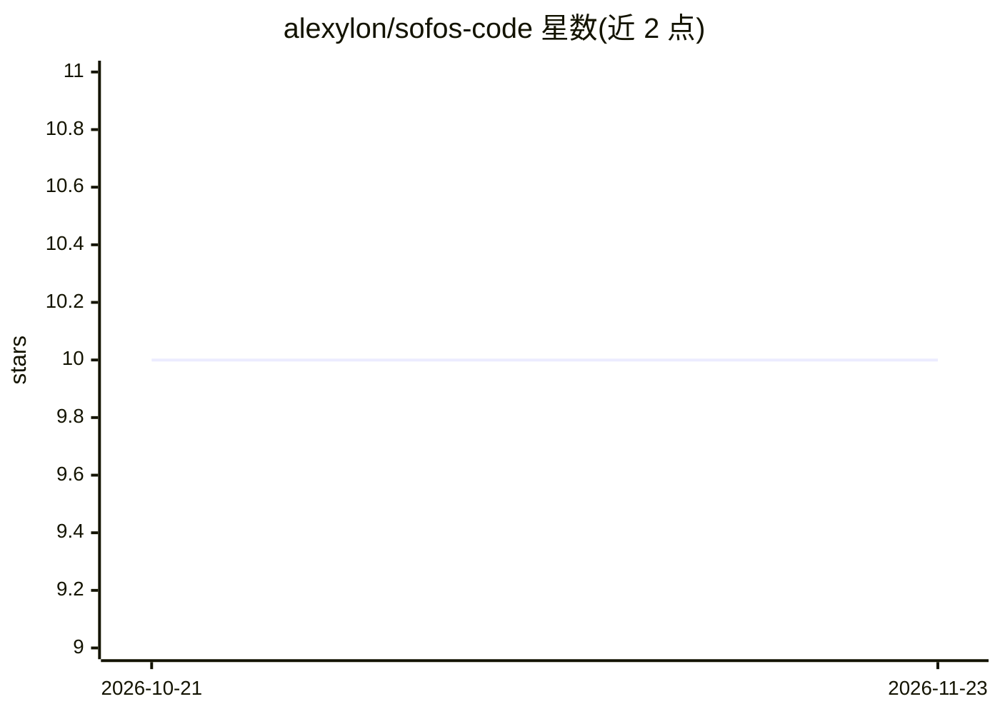

# alexylon/sofos-code

⭐ 10 · Rust · Apache-2.0 · 推送 2026-11-19 · [GitHub](https://github.com/alexylon/sofos-code) · 个人维护

**面向软件开发者的终端 AI 编码助手，接入 Claude/OpenAI 与本地工具**

用 Rust 编写的终端内 AI 编码助手，把 Claude 或 OpenAI 模型接入本地工具链：文件读写与编辑（精确替换/Morph Apply）、ripgrep 代码搜索、执行经审批的构建测试命令、网页搜索与图像查看，并可通过 MCP 连接外部工具。访问模型显式分级：工作区文件默认可读，外部路径与高风险操作需按五种权限预设批准；危险命令被拦截。支持流式 Markdown、多步工具循环、会话保存恢复、token 成本统计与上下文压缩。macOS/Linux 提供预编译二进制，也可用 Cargo 安装或从源码构建。

## 筛选速览

| 维度 | 判定 | 备注 |
|---|---|---|
| AI 角色 | `ai-native` | 本体是模型或模型工具 |
| 许可风险 | `permissive` | Apache-2.0 |
| 部署形态 | `desktop` | 安装包/桌面程序 |
| 模型依赖 | locked-api |  |
| 硬件要求 | — | 无带数字的原话,不猜 |
| 安装摩擦 | `medium` | 含编译或系统依赖之一 |
| 成熟度 | — | 结构信号不足 |

## 能力要点

- 五种权限预设（read-only 至 unsandboxed）与 Bash 结构性安全检查
- 支持 stdio 与 streamable HTTP 的 MCP 服务器集成
- 多步迭代工具调用、会话持久化与按响应计价的成本统计
- 图像视觉：本地文件、远程 URL 与剪贴板粘贴

## 适用场景

- 在终端里让 AI 检查、编辑项目代码并运行测试
- 用一次性命令让 AI 定位失败测试或审查错误处理
- 通过 MCP 把外部工具接入编码助手工作流
- 需要明确权限分级和沙箱约束的团队使用 AI 编码

## 场景标签

`编码 Agent` · 领域:编码与开发

## 证据(README 行号)

> L5: Sofos Code is a terminal-based AI coding assistant for software projects. It connects Claude or OpenAI models to loc
> L17: Sofos provides an AI assistant with controlled access to your project from inside the terminal. It can:
> L44: - **MCP integration** — Tools from stdio or streamable HTTP MCP servers.

## 星数曲线

2026-10-21 10 → 2026-11-23 10（+0）

---
*卡片 v1 · prompt 1.4 · 生成 2026-11-20 · 置信度 high · 依据 README sha `f7d8ec039f4d` · [字段定义](../../DATASET.md)*
