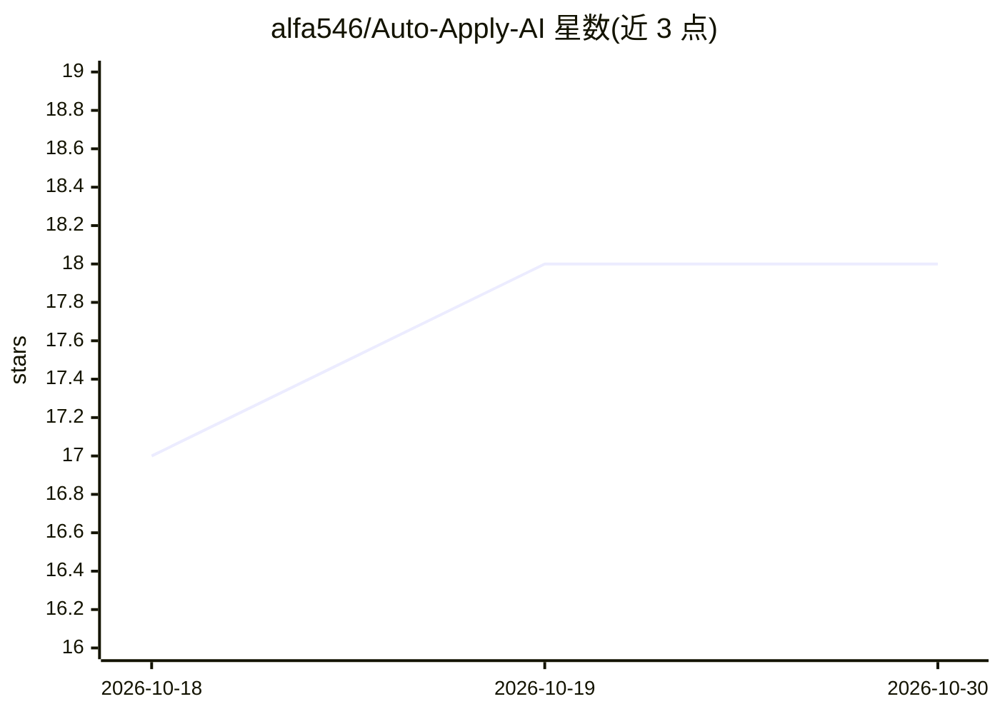

# alfa546/Auto-Apply-AI

⭐ 18 · Python · MIT · 推送 2026-08-27 · [GitHub](https://github.com/alfa546/Auto-Apply-AI) · 个人维护

**自动化求职的多 agent 工作台：简历 ATS 评估、抓岗、自动投递**

面向求职者与工程师的自主多 agent 工作台：原生解析 PDF/Word 简历并按 ATS 启发式打分；聚合 Adzuna、Jooble API 与多国自定义爬虫获取职位；用 LLM 做兼容度匹配并生成求职信；通过 Playwright 无头浏览器填写外部门户表单，经 Gmail OAuth2/SMTP 以随机延迟与每日限额自动投递并监控回复。LLM 支持本地 Ollama/LM Studio 及 OpenAI、Gemini、Groq、DeepSeek 等云端接入。技术栈为 Next.js 16 + FastAPI + Playwright，提供单命令启动脚本与 Docker Compose 生产部署（PostgreSQL/Redis/Nginx）。

## 筛选速览

| 维度 | 判定 | 备注 |
|---|---|---|
| AI 角色 | `ai-native` | 本体是模型或模型工具 |
| 许可风险 | `permissive` | MIT |
| 部署形态 | `self-host` | docker 或自建部署 |
| 模型依赖 | local-ok | 支持本地模型 |
| 硬件要求 | — | 无带数字的原话,不猜 |
| 安装摩擦 | `low` | 无编译、无系统依赖或容器化 |
| 成熟度 | — | 结构信号不足 |

## 能力要点

- 原生 PDF/DOCX 解析与 ATS 评分（格式密度、动词频率、联系方式可见性）
- Adzuna/Jooble API + 多国爬虫 + 后台定时刷新的职位聚合
- Playwright 无头表单填写与 Gmail 自动投递（随机 8-10 分钟延迟、每日限额）
- LLM 可接本地 Ollama/LM Studio 或 OpenAI/Gemini/Groq/DeepSeek/OpenRouter

## 适用场景

- 批量解析简历并按 ATS 规则评分改进
- 自动抓取多国职位并用 LLM 生成定制求职信投递
- 监控 Gmail 收件箱并对 HR 回复分类生成回复草稿

## 场景标签

`多智能体` `浏览器自动化` `网页抓取` · 领域:Agent 开发

## 证据(README 行号)

> L27: **Auto-Apply AI** is an intelligent, autonomous multi-agent automation platform designed to transform modern job hu
> L32: 3. **LLM Compatibility Matcher & AI Cover Letters**: Evaluates candidate compatibility and generates highly persuas

## 星数曲线

2026-10-18 17 → 2026-10-30 18（+1）

---
*卡片 v1 · prompt 1.4 · 生成 2026-10-29 · 置信度 mid · 依据 README sha `b7a61e8ea32a` · [字段定义](../../DATASET.md)*
