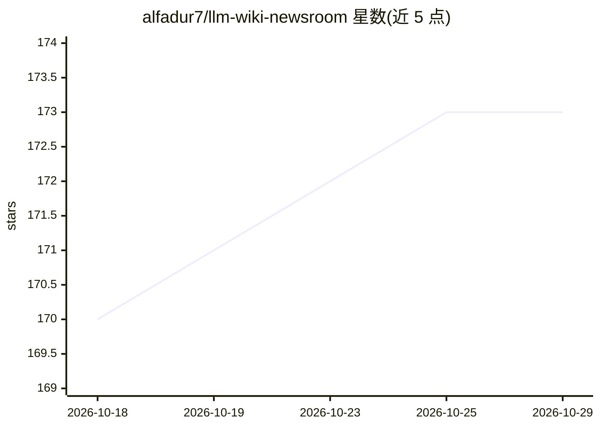

# alfadur7/llm-wiki-newsroom

⭐ 173 · Python · MIT · 推送 2026-10-13 · [GitHub](https://github.com/alfadur7/llm-wiki-newsroom) · [官网](https://alfadur7.github.io/llm-wiki-newsroom/) · 个人维护

**多角色 agent 新闻室：把文档自动整理成互链 markdown 维基**

基于 Claude Code 等 agent 的本地优先知识库系统：将文章、文档、PDF 放入 raw/ 目录后，由五个角色（Reporter/Columnist/Copy Editor/Desk/Editor-in-Chief）组成的"新闻室"读取、抽取实体概念与关系，产出互链 wiki——写页面的 agent 与审页面的角色分离，通过 Inner/Outer/Meta/Reground 四个循环与确定性 lint 双重门控维护质量；写作规则可经 meta loop 自我修订，已发布页面过期后回流重加工。输出为纯 markdown/Obsidian 兼容页面与交互式知识图谱，Python 工具本地运行、无需 API key。Claude Code 支持全部 9 个斜杠命令，Codex/Gemini CLI 仅基础工作流。

## 筛选速览

| 维度 | 判定 | 备注 |
|---|---|---|
| AI 角色 | `ai-native` | 本体是模型或模型工具 |
| 许可风险 | `permissive` | MIT |
| 部署形态 | `library` | 以包/库形式分发 |
| 模型依赖 | locked-api |  |
| 硬件要求 | — | 无带数字的原话,不猜 |
| 安装摩擦 | `low` | 无编译、无系统依赖或容器化 |
| 成熟度 | `idea` | |

## 能力要点

- 五角色新闻室分工，写稿与审稿分离，lint+定性评审双门控
- meta loop 让写作规则自我修订（含盲测 A/B 与操作员签字）
- Reground 循环将过期页面回流为工厂输入
- 纯 markdown/Obsidian 输出与交互式知识图谱浏览器

## 适用场景

- 把收集的文章和 PDF 自动整理成互链可检索的知识库
- 维护会随新文档自动更新关联页面的个人维基
- 通过关联发现和时间线浏览跨文档的隐含联系

## 场景标签

`多智能体` `知识库管理` `知识图谱` `文档解析` · 领域:Agent 开发

## 证据(README 行号)

> L5: **A multi-agent AI knowledge base run by a five-role "newsroom" — open-source, local-first, no vendor lock-in.** Dro
> L21: **2. The factory is a newsroom running four loops.** The wiki is produced by five roles modeled on a newspaper staf
> L27: |**Copy Editor**|rule-based Python checks — not an LLM at all|

## 星数曲线

2026-10-18 170 → 2026-10-29 173（+3）

---
*卡片 v1 · prompt 1.4 · 生成 2026-10-22 · 置信度 mid · 依据 README sha `36acd8c615e3` · [字段定义](../../DATASET.md)*
