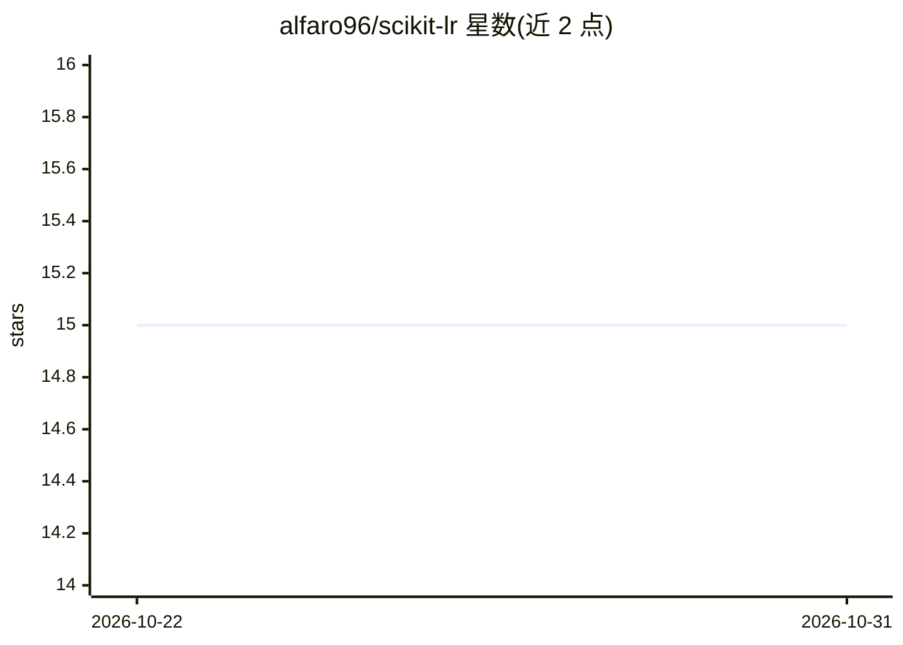

# alfaro96/scikit-lr

⭐ 15 · Python · MIT · 推送 2026-10-23 · [GitHub](https://github.com/alfaro96/scikit-lr) · [官网](https://alfaro96.github.io/scikit-lr/) · 个人维护

**scikit-learn 兼容的标签排序与偏标签排序机器学习库**

基于 scikit-learn 构建的 Python 机器学习库，解决标签排序与偏标签排序问题：为每个样本预测一组标签的完整排序（偏标签排序允许并列）。提供最近邻与决策树排序器、将标签排序分解为标准学习问题的分解式排序器、dummy 排序器及配套评价指标，全部遵循 scikit-learn API，可配合管道、交叉验证与超参数搜索使用。2019 年起源于 Juan Carlos Alfaro Jiménez 的博士论文，MIT 许可发布。

## 筛选速览

| 维度 | 判定 | 备注 |
|---|---|---|
| AI 角色 | `ai-native` | 本体是模型或模型工具 |
| 许可风险 | `permissive` | MIT |
| 部署形态 | `library` | 以包/库形式分发 |
| 模型依赖 | — | README 未给出锁定关系 |
| 硬件要求 | — | 无带数字的原话,不猜 |
| 安装摩擦 | `low` | 无编译、无系统依赖或容器化 |
| 成熟度 | — | 结构信号不足 |

## 能力要点

- 提供最近邻与决策树两类排序器，覆盖标签排序与偏标签排序
- 遵循 scikit-learn API，可配合 pipeline、交叉验证、超参数搜索
- 包含分解式标签排序器与 dummy 排序器及评价指标

## 适用场景

- 我在做偏好学习/标签排序任务，需要 sklearn 风格的估计器
- 我想把标签排序模型纳入现有的 sklearn 流水线与调参流程
- 需要用 dummy 排序器作为基线对比

## 场景标签

 · 领域:机器学习/偏好学习

## 证据(README 行号)

> L5: scikit-lr is a Python package for label ranking and partial label ranking, built on top of scikit-learn and distribu
> L7: In label ranking, each sample is associated with a ranking of a fixed set of labels instead of a single class, and t

## 星数曲线

2026-10-22 15 → 2026-10-31 15（+0）

---
*卡片 v1 · prompt 1.4 · 生成 2026-10-30 · 置信度 high · 依据 README sha `f4efacc36aed` · [字段定义](../../DATASET.md)*
