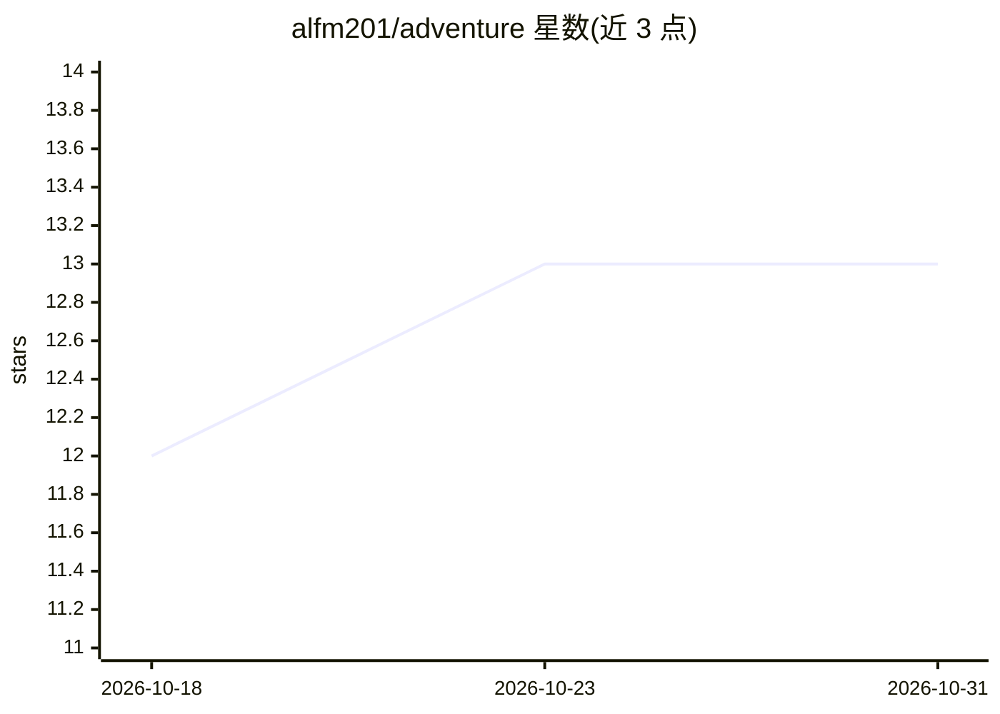

# alfm201/adventure

⭐ 13 · JavaScript · NOASSERTION · 推送 2026-10-29 · [GitHub](https://github.com/alfm201/adventure) · [官网](https://alfm201.github.io/adventure/) · 个人维护 · 中文 README

**拉泰尔Adventure游戏AI策略推荐网页应用：推荐骰子与卡牌选择**

为拉泰尔（Latale）Adventure小游戏提供骰子与卡牌下一步选择推荐的网页应用，用户自行操作游戏。支持三种模式：读取游戏画面的辅助模式、手动输入状态、自动处理已按键结果。提供 VELA v4.2、LYRA v2、X36·G3 三个自研策略模型（CPU/GPU 前向评估与模拟），语音支持韩/英/日/中及男女声（Gemini TTS 预生成）。本地运行需 Node.js 22+，模型文件从 GitHub Releases 或 Cloudflare 下载（各约 68MB）。代码与自研模型以 0BSD 提供，游戏图像与识别模板不在许可范围内。

## 筛选速览

| 维度 | 判定 | 备注 |
|---|---|---|
| AI 角色 | `ai-native` | 本体是模型或模型工具 |
| 许可风险 | `none` | NOASSERTION |
| 部署形态 | `None` |  |
| 模型依赖 | — | README 未给出锁定关系 |
| 硬件要求 | — | 无带数字的原话,不猜 |
| 安装摩擦 | `low` | 无编译、无系统依赖或容器化 |
| 成熟度 | — | 结构信号不足 |

## 能力要点

- 三种输入模式：画面识别辅助、手动输入、自动处理结果
- VELA/LYRA/X36 三个自研策略模型，CPU/GPU 可选，失败时回退 CPU
- 模型包约 68MB，浏览器同意存储后可复用；也支持本地文件运行
- 语音支持韩/英/日/中与男女声，Gemini TTS 预生成

## 适用场景

- 玩 Adventure 小游戏时获得骰子与卡牌的下一步推荐
- 不想截屏识别时手动输入状态获取建议
- 在本地 Node.js 环境离线运行推荐器

## 场景标签

 · 领域:游戏/桌面AI辅助

## 证据(README 行号)

> L5: 어드벤처 게임에서 주사위와 카드의 다음 선택을 추천하는 웹앱입니다. 연결한 게임 화면을 읽는 **어시스트**, 상태를 직접 입력하는 **수동**, 누른 주사위·카드의 결과를 처리하는 **자동** 모드를 지원합
> L13: |**LYRA · v2 (연구용)**|CPU 또는 GPU에서 신경망과 1-step 탐색으로 행동 평가|연구 평가 약 1,880점|
> L14: |**VELA · v4.2**|CPU로 다음 상황을 전개해 행동 평가|약 1,877점|

## 星数曲线

2026-10-18 12 → 2026-10-31 13（+1）

---
*卡片 v1 · prompt 1.4 · 生成 2026-10-31 · 置信度 high · 依据 README sha `a456610cf8bc` · [字段定义](../../DATASET.md)*
