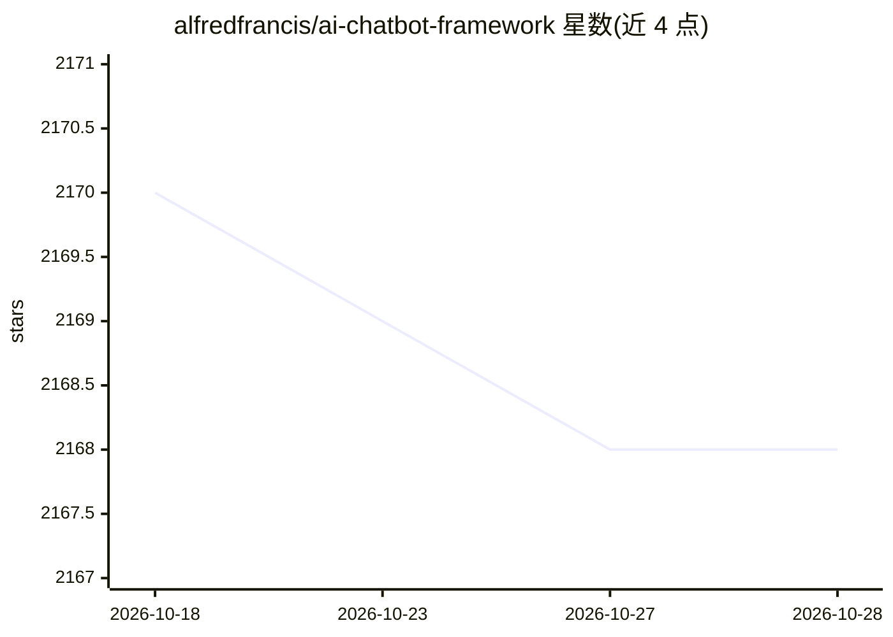

# alfredfrancis/ai-chatbot-framework

⭐ 2,167 · TypeScript · MIT · 推送 2026-08-26 · [GitHub](https://github.com/alfredfrancis/ai-chatbot-framework) · 个人维护

**自托管低代码聊天机器人构建平台，含 NLU 与 LLM 能力**

开源、自托管的 Python 聊天机器人搭建平台，提供低代码管理面板创建多轮对话场景，无需编程即可训练对话。NLU 能力包括 Spacy 词向量、基于 ML 的意图识别与实体抽取，以及用 LLM 做零样本 NLU；支持工具调用、持久记忆与上下文管理，RAG 知识库问答标注为开发中。可接入 Web REST API/聊天组件、Facebook Messenger，Slack 与 WhatsApp(Twilio) 标注即将支持。技术栈为 Python/FastAPI/MongoDB/React，支持 Docker 部署。

## 筛选速览

| 维度 | 判定 | 备注 |
|---|---|---|
| AI 角色 | `ai-ecosystem` | LLM/agent 周边工具 |
| 许可风险 | `permissive` | MIT |
| 部署形态 | `None` |  |
| 模型依赖 | — | README 未给出锁定关系 |
| 硬件要求 | — | 无带数字的原话,不猜 |
| 安装摩擦 | `low` | 无编译、无系统依赖或容器化 |
| 成熟度 | `idea` | |

## 能力要点

- 低代码 DIY 管理面板创建对话场景
- Spacy 词向量 + ML 意图识别与实体抽取 + LLM 零样本 NLU
- 工具调用（API request fulfilment）与持久记忆/上下文管理
- 多渠道接入：Web/Messenger，Slack 与 WhatsApp 开发中

## 适用场景

- 零代码搭建带 NLU 能力的客服或问答机器人
- 自托管部署多轮对话机器人并接入 Messenger 等渠道
- 通过管理面板训练与调试对话流程

## 场景标签

`聊天机器人` · 领域:对话与助手

## 证据(README 行号)

> L5: AI Chatbot Framework is an open-source, self-hosted, DIY Chatbot building platform built in Python. With this tool, 
> L14: - Low-Code, DIY Admin Dashboard for Bot Development
> L18: - Advanced Natural Language Understanding (NLU)

## 星数曲线

2026-10-18 2,170 → 2026-10-28 2,168（-2）

---
*卡片 v1 · prompt 1.4 · 生成 2026-10-21 · 置信度 high · 依据 README sha `cd64d2902000` · [字段定义](../../DATASET.md)*
