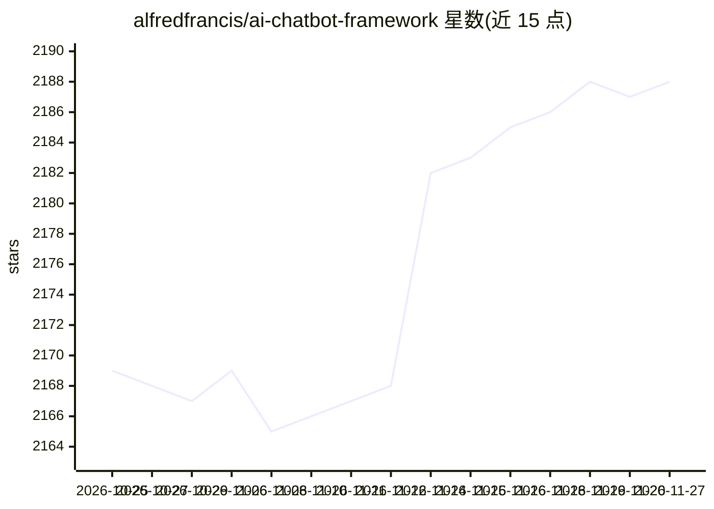

# alfredfrancis/ai-chatbot-framework

⭐ 2,188 · Python · MIT · 推送 2026-11-18 · [GitHub](https://github.com/alfredfrancis/ai-chatbot-framework) · 个人维护

**自托管团队 AI 助手：每人一个带私有沙盒电脑的 agent**

自托管的多用户 AI agent 平台。版本 2 由意图/实体 NLU 聊天机器人构建器重建为 agent（旧代码留在 git 历史）。面向想直接干活的用户：输入需求后 agent 读取文件、运行代码、调用应用。机制包括：每用户一个 Docker 沙盒（持久 /workspace、资源限制、无 Linux capabilities）、四工具 agent 循环、子 agent 并行、纯文件记忆（context.md/memory.md）、Agent Skills 格式技能（11 个内置）、MCP 应用连接、定时任务。默认模型 Claude，可换任意 LangChain chat provider。依赖 PostgreSQL/Redis/Caddy，支持水平扩展；公开部署前需按文档准备 gVisor 等主机安全配置。

## 筛选速览

| 维度 | 判定 | 备注 |
|---|---|---|
| AI 角色 | `ai-native` | 本体是模型或模型工具 |
| 许可风险 | `permissive` | MIT |
| 部署形态 | `self-host` | docker 或自建部署 |
| 模型依赖 | local-ok | 支持本地模型 |
| 硬件要求 | — | 无带数字的原话,不猜 |
| 安装摩擦 | `low` | 无编译、无系统依赖或容器化 |
| 成熟度 | `idea` | |

## 能力要点

- 每用户一个 Docker 沙盒，含持久 /workspace 与资源限制
- 四工具 agent 循环（read/write/edit/bash）与并行子 agent
- 纯文件记忆 context.md/memory.md，agent 每轮读取并自行编辑
- MCP 应用连接（Linear/Notion/Jira 等一键配置）与 Agent Client Protocol

## 适用场景

- 团队自托管每人一个私有助手，数据留在自己服务器
- 让 agent 读写文件、跑代码并连接 Notion/Jira 等应用
- 用定时任务每天固定时间自动跑提示词

## 场景标签

`Agent 框架` `AI 助手` · 领域:Agent 开发

## 证据(README 行号)

> L5:  A self-hosted AI agent for everyone on your team.
> L25: Most agent tools are built for developers. This one is built for people who just want work done: they type
> L32: - **Any model.** Claude by default; OpenAI, Ollama, OpenRouter, vLLM, LiteLLM or any other

## 星数曲线

2026-10-25 2,169 → 2026-11-27 2,188（+19）

---
*卡片 v1 · prompt 1.4 · 生成 2026-11-23 · 置信度 mid · 依据 README sha `e43ea93c83fa` · [字段定义](../../DATASET.md)*
