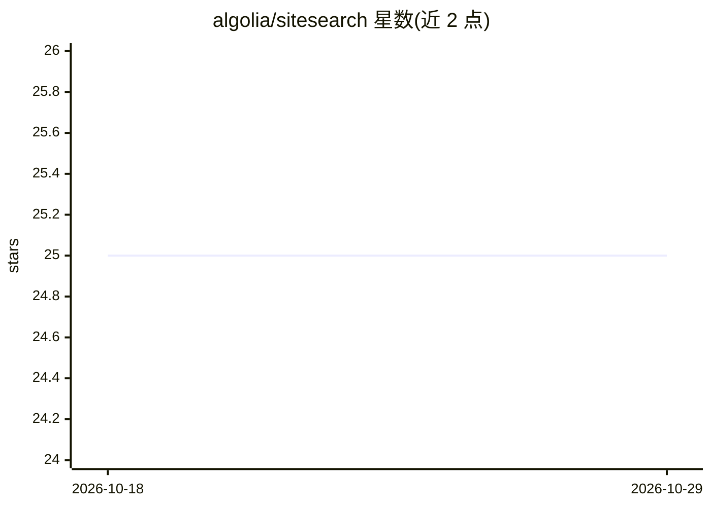

# algolia/sitesearch

⭐ 25 · TypeScript · MIT · 推送 2026-07-29 · [GitHub](https://github.com/algolia/sitesearch) · [官网](https://sitesearch.algolia.com) · 组织维护

**面向网站的搜索 UI 组件库，含 Ask AI 对话功能**

由 Algolia 官方维护的搜索组件库，基于 InstantSearch 提供搜索体验，包含 React 实现与可打包为原生 JS 的版本，可集成到现代 Web 应用。核心功能包括基于 Algolia 基础设施的即时搜索、可配置的 CSS 变量主题系统、WCAG 2.1 AA 无障碍支持，以及可选的 Ask AI 对话式问答界面（需单独创建 Ask AI assistant）。使用前需注册 Algolia 账号并配置索引与 Search API key，安装与集成步骤指向官方文档，仓库以 MIT 许可发布。

## 筛选速览

| 维度 | 判定 | 备注 |
|---|---|---|
| AI 角色 | `ai-enhanced` | 去掉 AI 部分产品仍成立 |
| 许可风险 | `permissive` | MIT |
| 部署形态 | `None` |  |
| 模型依赖 | — | README 未给出锁定关系 |
| 硬件要求 | — | 无带数字的原话,不猜 |
| 安装摩擦 | `low` | 无编译、无系统依赖或容器化 |
| 成熟度 | — | 结构信号不足 |

## 能力要点

- 提供 React 与原生 JS 两种形式的搜索组件
- Ask AI 对话式界面处理复杂查询（可选）
- CSS 变量主题系统与 WCAG 2.1 AA 无障碍支持

## 适用场景

- 为网站快速接入 Algolia 驱动的搜索界面
- 在搜索中加入对话式 AI 问答功能
- 通过主题变量定制搜索 UI 以匹配站点风格

## 场景标签

`聊天机器人` · 领域:对话与助手

## 证据(README 行号)

> L7: SiteSearch provides opinionated search components that showcases Algolia's lightning-fast search capabilities in the
> L13: - **🤖 AI-enhanced** - Conversational chat interface for complex queries using Ask AI

## 星数曲线

2026-10-18 25 → 2026-10-29 25（+0）

---
*卡片 v1 · prompt 1.4 · 生成 2026-10-27 · 置信度 high · 依据 README sha `3195b6957953` · [字段定义](../../DATASET.md)*
