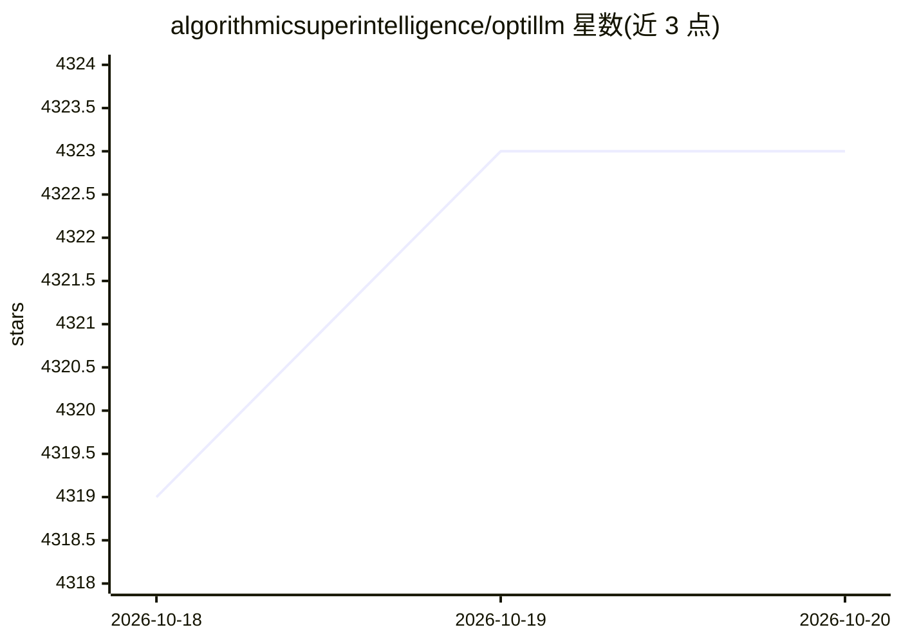

# algorithmicsuperintelligence/optillm

⭐ 4,323 · Python · Apache-2.0 · 推送 2026-10-11 · [GitHub](https://github.com/algorithmicsuperintelligence/optillm) · 组织维护

**OpenAI 兼容的 LLM 推理优化代理：免训练提升推理准确率**

OptiLLM 是一个 OpenAI API 兼容的优化推理代理服务器，客户端只需把 base_url 指向它即可接入。它实现 20 余种推理时优化技术（MARS、CePO、MCTS、PlanSearch、Best-of-N 等）和 15 个插件（MCP 客户端、记忆、PII 匿名化、代码执行、结构化输出、多提供商负载均衡等），通过额外推理时计算在不训练模型的情况下改进数学、编码与逻辑推理表现。支持 OpenAI、Azure、Cerebras 等提供商，可经 LiteLLM 接入 100 余个模型。安装提供 pip、Docker（含 proxy-only 与 offline 变体）与源码三种方式，默认绑定 127.0.0.1。

## 筛选速览

| 维度 | 判定 | 备注 |
|---|---|---|
| AI 角色 | `ai-ecosystem` | LLM/agent 周边工具 |
| 许可风险 | `permissive` | Apache-2.0 |
| 部署形态 | `self-host` | docker 或自建部署 |
| 模型依赖 | local-ok | 支持本地模型 |
| 硬件要求 | — | 无带数字的原话,不猜 |
| 安装摩擦 | `low` | 无编译、无系统依赖或容器化 |
| 成熟度 | — | 结构信号不足 |

## 能力要点

- 实现 20+ 推理优化技术（MARS/CePO/MCTS/PlanSearch 等）
- OpenAI API 兼容，改 base_url 即可作为 drop-in 接入
- 插件体系：MCP 客户端、短期记忆、PII 匿名化、代码执行、多提供商负载均衡
- 提供 pip / Docker（含 proxy-only、offline 变体）/ 源码安装

## 适用场景

- 把现有应用的 OpenAI 调用切到代理以获得推理时优化
- 无需微调模型即在数学/编码任务上提升准确率
- 在多个 LLM 提供商之间做负载均衡与故障切换
- 通过 MCP 客户端插件让任意 LLM 使用 MCP Server

## 场景标签

`模型网关` `推理引擎` · 领域:Agent 开发

## 证据(README 行号)

> L15: **OptiLLM** is an OpenAI API-compatible optimizing inference proxy that implements 20+ state-of-the-art techniques 
> L225: Once the proxy is running, you can use it as a drop in replacement for an OpenAI client by setting the `base_url` 

## 星数曲线

2026-10-18 4,319 → 2026-10-20 4,323（+4）

---
*卡片 v1 · prompt 1.4 · 生成 2026-10-20 · 置信度 high · 依据 README sha `541647690b0a` · [字段定义](../../DATASET.md)*
