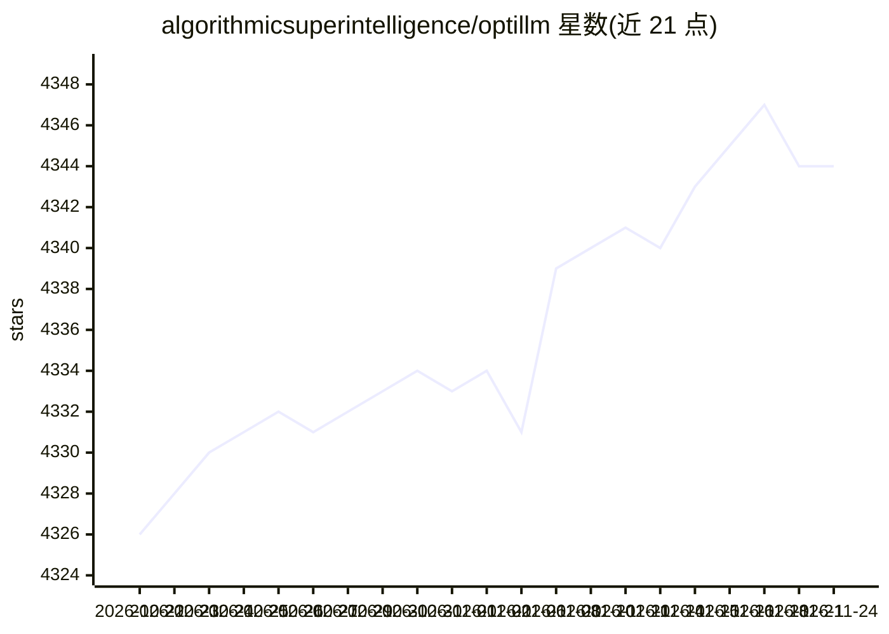

# algorithmicsuperintelligence/optillm

⭐ 4,343 · Python · Apache-2.0 · 推送 2026-11-16 · [GitHub](https://github.com/algorithmicsuperintelligence/optillm) · 组织维护

**OpenAI 兼容的 LLM 推理优化代理：以推理时技术提升准确率**

以代理服务器形式部署的推理优化层：将现有 OpenAI 客户端指向本地端口，通过在模型名前加技术前缀启用 20+ 种推理时优化方法（best-of-N、MCTS、自洽性、CoT 反思、Z3 求解器等），支持用 & 串行管道和 | 并行组合技术。内置本地推理服务器可加载 HuggingFace 模型与 LoRA 适配器，另含负载均衡网关插件与 MCP 客户端插件。需配置 API key 或本地模型；流式输出在旧版 completions 端点不支持。

## 筛选速览

| 维度 | 判定 | 备注 |
|---|---|---|
| AI 角色 | `ai-ecosystem` | LLM/agent 周边工具 |
| 许可风险 | `permissive` | Apache-2.0 |
| 部署形态 | `self-host` | docker 或自建部署 |
| 模型依赖 | local-ok | 支持本地模型 |
| 硬件要求 | — | 无带数字的原话,不猜 |
| 安装摩擦 | `low` | 无编译、无系统依赖或容器化 |
| 成熟度 | — | 结构信号不足 |

## 能力要点

- 20+ 推理时优化技术，模型名前缀即可选择，支持 & 与 | 组合
- OpenAI API 兼容，任何 OpenAI 客户端可作为 drop-in 接入
- 内置本地推理服务器：加载 HuggingFace 模型与 LoRA 适配器，支持 cot/entropy decoding
- proxy 插件提供自托管网关：负载均衡、failover、健康检查
- MCP 插件连接 MCP 服务器，支持 stdio/sse/streamable_http 传输

## 适用场景

- 不训练模型的前提下提升已有 LLM 在数学/代码/逻辑推理上的准确率
- 自托管 LLM 网关做多供应商负载均衡与故障转移
- 通过 MCP 让任意 LLM 调用工具与资源
- 对长文档做分治处理或压缩上下文以扩展可用长度

## 场景标签

`推理引擎` `模型网关` · 领域:Agent 开发

## 证据(README 行号)

> L15: **OptiLLM** is an OpenAI API-compatible optimizing inference proxy that implements 20+ state-of-the-art techniques 
> L22: - **Drop-in replacement**: Works with any OpenAI-compatible API endpoint
> L182: The `proxy` plugin turns OptiLLM into a self-hosted gateway with load balancing, failover, and health checks acros

## 星数曲线

2026-10-22 4,326 → 2026-11-24 4,344（+18）

---
*卡片 v1 · prompt 1.4 · 生成 2026-11-22 · 置信度 high · 依据 README sha `0c722c7929e7` · [字段定义](../../DATASET.md)*
