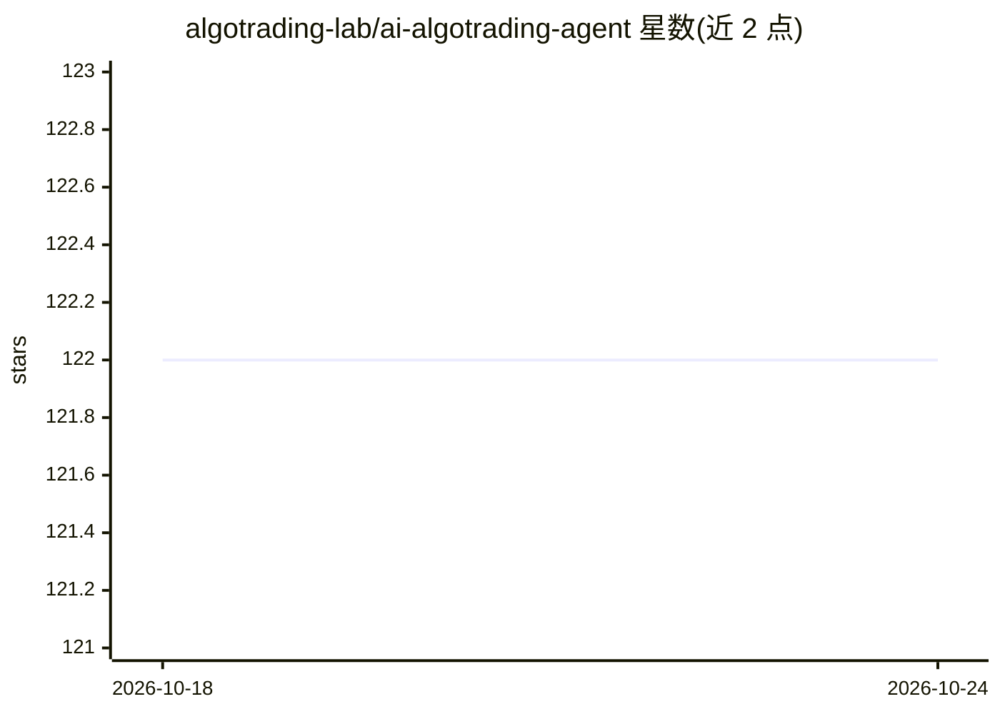

# algotrading-lab/ai-algotrading-agent

⭐ 122 · Python · MIT · 推送 2026-06-17 · [GitHub](https://github.com/algotrading-lab/ai-algotrading-agent) · 组织维护

**加密货币算法交易框架（TypeScript）：回测与逐 tick 重放**

TypeScript 编写的加密货币算法交易工具包，由原 Python 框架移植并保持相同策略语义。提供回测、逐 tick 重放两种运行模式（实时模式为占位 stub，需自行接入交易所 WebSocket），读取 hist-{interval}/*.csv 蜡烛数据，支持 SMA 交叉默认策略、固定/追踪止损与手续费扣除配置。仓库命名与主题标签含 ai-agent/ai-trading-agent，但 README 正文未描述 AI 模型调用机制；另保留旧版 Python 包（依赖 Pandas/Matplotlib/InfluxDB 等）。面向量化交易开发者，附风险声明，非投资建议。

## 筛选速览

| 维度 | 判定 | 备注 |
|---|---|---|
| AI 角色 | `ai-enhanced` | 去掉 AI 部分产品仍成立 |
| 许可风险 | `permissive` | MIT |
| 部署形态 | `library` | 以包/库形式分发 |
| 模型依赖 | — | README 未给出锁定关系 |
| 硬件要求 | — | 无带数字的原话,不猜 |
| 安装摩擦 | `low` | 无编译、无系统依赖或容器化 |
| 成熟度 | — | 结构信号不足 |

## 能力要点

- 回测与逐 tick 重放两种运行模式，实时模式为占位 stub
- 从 Python 框架移植，保持相同 SMA 交叉策略语义与 CSV 数据布局
- 固定/追踪止损、手续费扣除、Redis 可选回测缓存等配置项
- 保留旧版 Python 包（cryptoalgotrading/）

## 适用场景

- 在历史蜡烛数据上回测 SMA 交叉等策略
- 逐 tick 重放验证策略执行逻辑
- 对照 TypeScript 版与原 Python 版策略语义是否一致

## 场景标签

`金融量化` · 领域:学习与行业

## 证据(README 行号)

> L1: # Crypto AlgoTrading Framework (TypeScript)
> L3: > Algorithmic trading toolkit for crypto — **backtest**, **tick-by-tick replay**, and **simulation** modes. Ported f

## 星数曲线

2026-10-18 122 → 2026-10-24 122（+0）

---
*卡片 v1 · prompt 1.4 · 生成 2026-10-23 · 置信度 low · 依据 README sha `9683b3fab7fd` · [字段定义](../../DATASET.md)*
