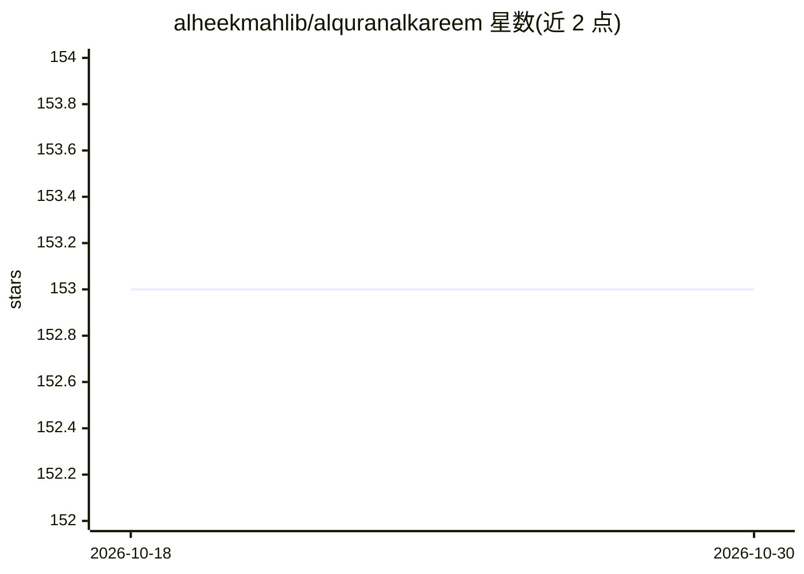

# alheekmahlib/alquranalkareem

⭐ 153 · Dart · 推送 2026-10-26 · [GitHub](https://github.com/alheekmahlib/alquranalkareem) · [官网](https://alhikmah.vexaltech.dev/download/quran) · 组织维护

**Flutter 跨平台古兰经阅读与背诵应用，含 AI 背诵核验与助手**

基于 Flutter 的开源古兰经应用，覆盖 Android/iOS/macOS/Windows 等平台，采用法赫德国王版 Mushaf 排版。核心功能包括逐页与逐节阅读、多诵读者音频、Tasmee 背诵测试——通过设备端 ONNX 语音模型逐词核验诵读并提供纠错与跟读模式；另有基于 BM25+向量检索+MCP 的自然语言古兰经问答助手（需在 assets/.env 配置 API key，其余功能无 key 可用）、tafsir/圣训知识库、赞词、日历与 QR 设备同步。通过各应用商店安装或从源码构建。

## 筛选速览

| 维度 | 判定 | 备注 |
|---|---|---|
| AI 角色 | `ai-enhanced` | 去掉 AI 部分产品仍成立 |
| 许可风险 | `none` | — |
| 部署形态 | `desktop` | 安装包/桌面程序 |
| 模型依赖 | locked-api |  |
| 硬件要求 | — | 无带数字的原话,不猜 |
| 安装摩擦 | `low` | 无编译、无系统依赖或容器化 |
| 成熟度 | — | 结构信号不足 |

## 能力要点

- 设备端 ONNX 语音模型逐词核验诵读（Tasmee/纠错/跟读三种模式）
- 自然语言古兰经问答：BM25+向量嵌入+MCP 混合检索，多 LLM 供应商可配置
- 法赫德国王版 Mushaf 逐页排版与逐词交互、10 种界面语言
- QR 码配对的跨设备同步（自托管 Cloudflare Worker + D1，无需账号）

## 适用场景

- 逐页阅读古兰经并配合多诵读者音频跟读
- 背诵测试：遮盖经文凭记忆诵读，由应用逐词核验纠错
- 用自然语言提问并获取带出处的古兰经答案
- 阅读 tafsir、圣训等伊斯兰典籍并做书签与进度管理

## 场景标签

`文档问答` `语音识别` · 领域:知识与检索

## 证据(README 行号)

> L57: **Al-Quran Al-Kareem (القرآن الكريم — مكتبة الحكمة)** is a free, open-source Quran application built with Flutter f
> L73: The flagship section. Open the Quran page, tap the mic, and recite — the app verifies your recitation word by word,
> L95: - **Natural-language Quran search** — ask questions and get answers grounded in the Quran, powered by a unified LLM

## 星数曲线

2026-10-18 153 → 2026-10-30 153（+0）

---
*卡片 v1 · prompt 1.4 · 生成 2026-10-22 · 置信度 mid · 依据 README sha `b65f58aa517d` · [字段定义](../../DATASET.md)*
