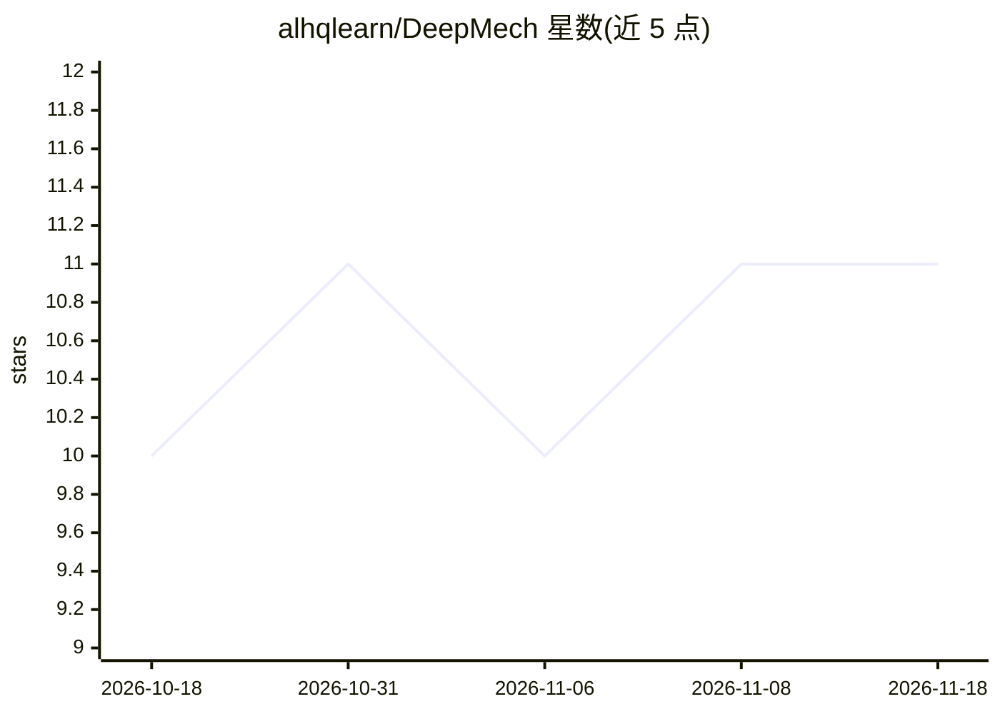

# alhqlearn/DeepMech

⭐ 11 · Python · MIT · 推送 2026-07-15 · [GitHub](https://github.com/alhqlearn/DeepMech) · 个人维护

**预测化学反应完整机理的图深度学习框架**

DeepMech 是面向化学反应机理预测（CRM）的可解释图深度学习框架，通过 git clone 获取源码，从 Zenodo 下载配套数据集与预训练模型后，依次运行预处理、训练与推理脚本；支持单步预测、完整 ID-CRM 预测及对自定义输入 SMILES 的新机理预测，并可自建训练/验证/测试数据集。面向化学与机器学习方向的研究人员，配套学术论文并给出引用条目。

## 筛选速览

| 维度 | 判定 | 备注 |
|---|---|---|
| AI 角色 | `ai-native` | 本体是模型或模型工具 |
| 许可风险 | `permissive` | MIT |
| 部署形态 | `None` |  |
| 模型依赖 | — | README 未给出锁定关系 |
| 硬件要求 | — | 无带数字的原话,不猜 |
| 安装摩擦 | `low` | 无编译、无系统依赖或容器化 |
| 成熟度 | — | 结构信号不足 |

## 能力要点

- 可解释的图（GNN/AttentiveFP 类）深度学习框架，预测完整化学反应机理
- 提供单步预测与完整 ID-CRM 预测两条推理路径
- 支持自建数据集（SMILES 格式 atom-mapped 基元步骤）与重新训练
- 数据集与预训练模型通过 Zenodo DOI 分发

## 适用场景

- 对给定反应物 SMILES 预测完整反应机理
- 在自己的反应数据上重新训练机理预测模型
- 复现论文中的化学反应机理预测实验

## 场景标签

`科研工具` · 领域:学习与行业

## 证据(README 行号)

> L3: DeepMech is an interpretable graph-based deep learning framework for predicting complete chemical reaction mechanism
> L57: python SingleStepPred.py
> L80: python NewCRM_Prediction.py

## 星数曲线

2026-10-18 10 → 2026-11-18 11（+1）

---
*卡片 v1 · prompt 1.4 · 生成 2026-11-18 · 置信度 high · 依据 README sha `25320f1d5018` · [字段定义](../../DATASET.md)*
