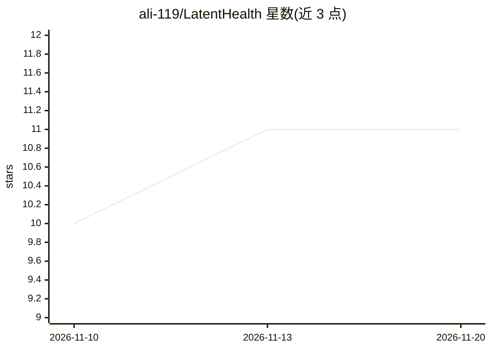

# ali-119/LatentHealth

⭐ 11 · Jupyter Notebook · MIT · 推送 2026-11-10 · [GitHub](https://github.com/ali-119/LatentHealth) · 个人维护

**面向公众的健康数据分析项目：从调查数据做患者表型分组与糖尿病风险打分**

以 NHANES 2013-2014 调查数据（6 张表、约 1,800 列）为输入的研究型项目：清洗与特征工程后得到 9,911 人 × 58 特征的数据集；无监督部分用 K-Means（k=4）、UMAP、PCA 做患者表型分组；有监督部分对 6 个分类器做 GridSearchCV 交叉验证并部署 KNN 模型；通过 Flask REST API 与四步问卷 Web 应用提供实时风险概率输出。限定为教育性估计而非诊断工具，笔记本路径需按本地环境调整。

## 筛选速览

| 维度 | 判定 | 备注 |
|---|---|---|
| AI 角色 | `ai-native` | 本体是模型或模型工具 |
| 许可风险 | `permissive` | MIT |
| 部署形态 | `None` |  |
| 模型依赖 | — | README 未给出锁定关系 |
| 硬件要求 | — | 无带数字的原话,不猜 |
| 安装摩擦 | `low` | 无编译、无系统依赖或容器化 |
| 成熟度 | — | 结构信号不足 |

## 能力要点

- 六张 NHANES 原始表融合为 9,911 人 × 58 特征的建模数据集
- K-Means（k=4）划分 4 个患者表型群组并给出各群患病率
- 6 个分类器 400+ 交叉验证拟合，最优 CV ROC-AUC 0.878
- Flask API 提供九项输入的实时糖尿病风险概率与三级标签

## 适用场景

- 复现基于 NHANES 数据的患者表型聚类研究
- 参考其端到端的数据清洗与特征工程流程
- 查看部署的机器学习模型作为 Flask Web 应用的教学示例

## 场景标签

 · 领域:医疗健康/数据科学

## 证据(README 行号)

> L11: **Unsupervised patient phenotyping and supervised diabetes-risk scoring, served through a real-time web app.**
> L29: |Unsupervised|Which natural patient groups exist in this population?|MinMax scaling, K-Means (k = 4), UMAP, PCA|
> L30: |Supervised|How likely is a person to have diabetes, given nine easy inputs?|Six classifiers, GridSearchCV, ROC-AUC

## 星数曲线

2026-11-10 10 → 2026-11-20 11（+1）

---
*卡片 v1 · prompt 1.4 · 生成 2026-11-19 · 置信度 high · 依据 README sha `fad99d927d09` · [字段定义](../../DATASET.md)*
