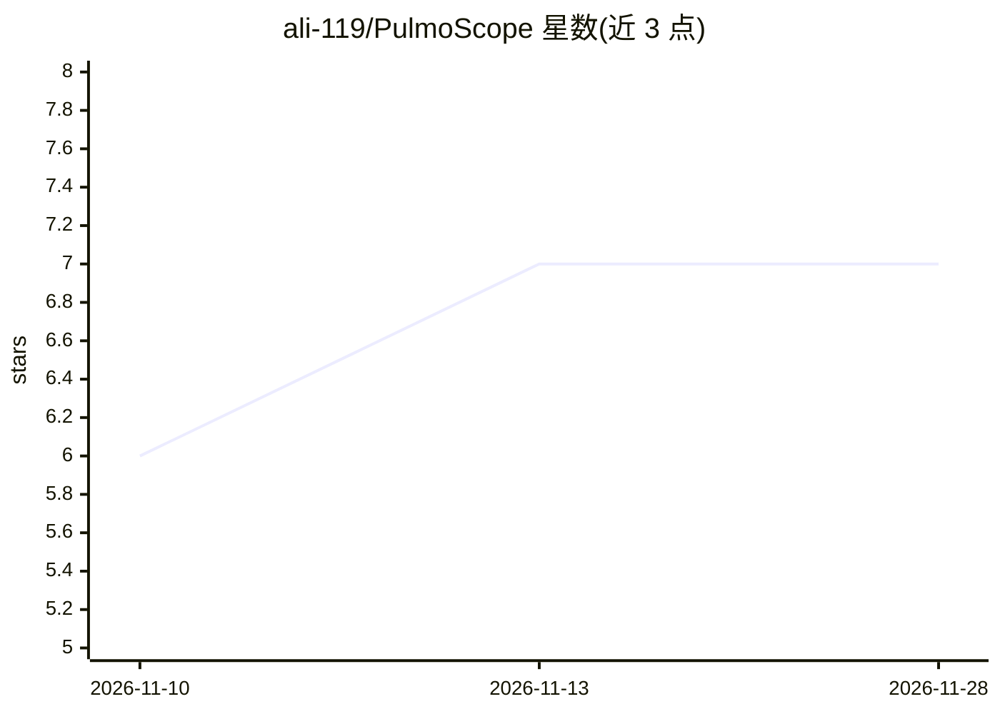

# ali-119/PulmoScope

⭐ 7 · Jupyter Notebook · MIT · 推送 2026-11-18 · [GitHub](https://github.com/ali-119/PulmoScope) · 个人维护

**面向研究者的肺结节 CT 多模型筛查决策管线**

三阶段 AI 系统处理胸部 CT：问卷风险评分（Gradient Boosting）、DenseNet121 二分类切片、U-Net（EfficientNetB0 编码器）分割结节并定位，规则融合层输出 suspicious/uncertain/no_findings 三种决策，各模型不一致时显式报告 uncertain。高风险问卷下调分类阈值 0.50→0.40。通过 FastAPI + 单页 UI 提供服务，支持 Colab 与本地运行。README 明确声明仅供研究教育用途，非医疗器械。

## 筛选速览

| 维度 | 判定 | 备注 |
|---|---|---|
| AI 角色 | `ai-native` | 本体是模型或模型工具 |
| 许可风险 | `permissive` | MIT |
| 部署形态 | `library` | 以包/库形式分发 |
| 模型依赖 | — | README 未给出锁定关系 |
| 硬件要求 | — | 无带数字的原话,不猜 |
| 安装摩擦 | `low` | 无编译、无系统依赖或容器化 |
| 成熟度 | — | 结构信号不足 |

## 能力要点

- 三模型规则融合决策，模型不一致时显式返回 uncertain 并说明来源
- 风险自适应分类阈值（高风险 0.50→0.40）
- 连通域分析输出结节包围框、面积与峰值置信度
- 按扫描分组的防泄漏训练切分

## 适用场景

- 肺部 CT 切片结节检测与定位的教学演示
- 多模型决策融合机制的科研参考实现
- 医学影像深度学习管线的搭建练习

## 场景标签

`科研工具` `目标检测` · 领域:学习与行业

## 证据(README 行号)

> L5:  A multi-stage AI system for pulmonary lesion detection and localization on chest CT
> L27: 2. Classifies the slice as **normal or abnormal** with a fine-tuned DenseNet121.
> L224: - Python 3.10 or newer

## 星数曲线

2026-11-10 6 → 2026-11-28 7（+1）

---
*卡片 v1 · prompt 1.4 · 生成 2026-11-20 · 置信度 high · 依据 README sha `dd20ea1871f1` · [字段定义](../../DATASET.md)*
