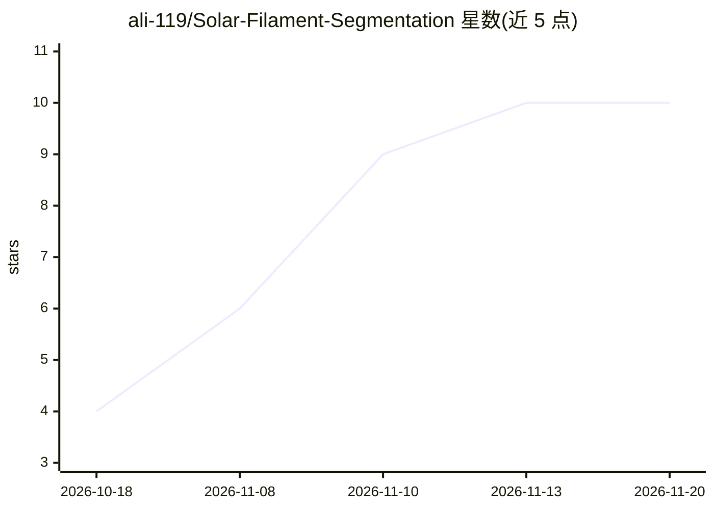

# ali-119/Solar-Filament-Segmentation

⭐ 10 · Jupyter Notebook · MIT · 推送 2026-11-09 · [GitHub](https://github.com/ali-119/Solar-Filament-Segmentation) · 个人维护

**太阳暗条分割研究项目：U-Net 与迁移学习对比基准**

基于 TensorFlow/Keras 的全日面 H-alpha 图像太阳暗条语义分割项目。工作流从 COCO 格式多边形标注动态生成二值掩码，对比三种方案：从零训练的 U-Net 基线（约1.37M参数）、冻结 EfficientNetB0 编码器的 U-Net、解冻最后40层做微调的版本，损失采用 0.3·BCE+0.7·Dice 加权应对极端类别不平衡。附 Kaggle 提交通道：1024×1024 分辨率训练，用连通域拆分为逐暗条实例并导出 RLE。数据集不随仓库附带，经 kagglehub 下载且需先接受竞赛规则。

## 筛选速览

| 维度 | 判定 | 备注 |
|---|---|---|
| AI 角色 | `ai-native` | 本体是模型或模型工具 |
| 许可风险 | `permissive` | MIT |
| 部署形态 | `library` | 以包/库形式分发 |
| 模型依赖 | — | README 未给出锁定关系 |
| 硬件要求 | — | 无带数字的原话,不猜 |
| 安装摩擦 | `low` | 无编译、无系统依赖或容器化 |
| 成熟度 | — | 结构信号不足 |

## 能力要点

- 三种 U-Net 方案对比：从零训练、冻结编码器、部分微调
- 0.3·BCE+0.7·Dice 加权损失应对极端类别不平衡
- 1024×1024 提交管线：连通域拆分实例并导出 RLE
- 以 Dice 系数评估并报告各配置验证结果

## 适用场景

- 复现太阳暗条分割实验并对比训练策略
- 参加 filament-segmentation-2026 竞赛生成提交文件
- 参考极不平衡稀疏目标的分割训练配置

## 场景标签

`目标检测` · 领域:感知与多模态

## 证据(README 行号)

> L4: A **deep learning semantic segmentation project** for detecting **solar filaments** in full-disk H-alpha images of t
> L57: |`Base CNN Model.ipynb`|U-Net from scratch (~1.37 M params)|Trained from scratch|BCE + Dice (1 : 1)|
> L63: - **Encoder:** EfficientNetB0 (ImageNet), only the last 40 layers trainable

## 星数曲线

2026-10-18 4 → 2026-11-20 10（+6）

---
*卡片 v1 · prompt 1.4 · 生成 2026-11-20 · 置信度 mid · 依据 README sha `186f50bda67f` · [字段定义](../../DATASET.md)*
