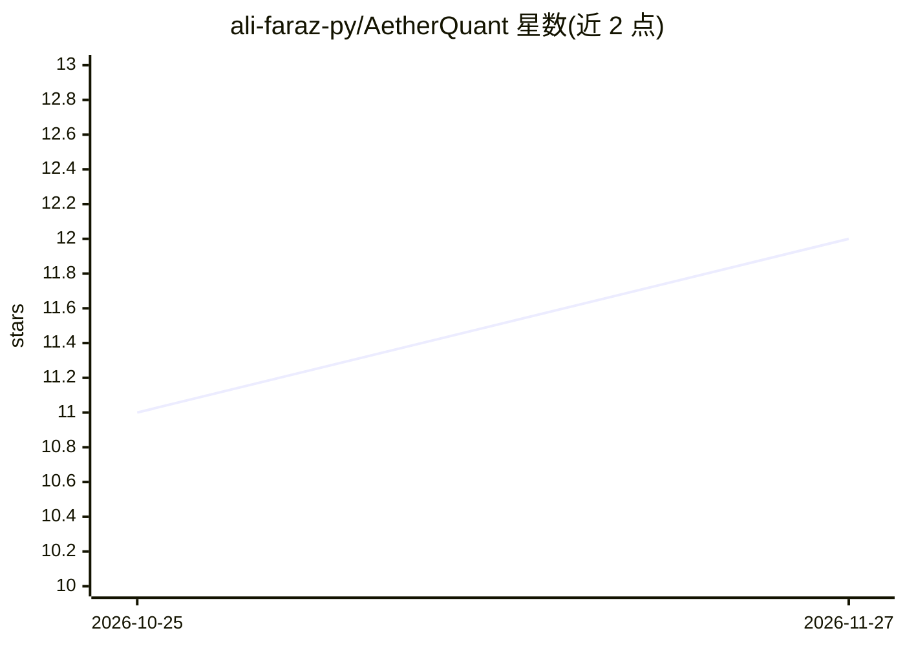

# ali-faraz-py/AetherQuant

⭐ 12 · JavaScript · 推送 2026-09-16 · [GitHub](https://github.com/ali-faraz-py/AetherQuant) · [官网](https://aether-quant-blush.vercel.app/) · 个人维护

**基于 XGBoost 的加密货币趋势预测仪表盘**

机器学习驱动的市场信号仪表盘：用 730 天小时级 BTC-USD 数据训练的 XGBoost 分类器，结合实时抓取的 24 个技术指标（RSI、MACD、VWAP、布林带等）判断短期涨跌并输出 BUY/SELL 信号。后端 FastAPI + 前端 Next.js 分离架构，提供交互式价格与 RSI 图表。README 明确标注模型仅基于 BTC-USD 训练，对其他资产的预测会被标记为可靠性较低。

## 筛选速览

| 维度 | 判定 | 备注 |
|---|---|---|
| AI 角色 | `ai-native` | 本体是模型或模型工具 |
| 许可风险 | `none` | — |
| 部署形态 | `library` | 以包/库形式分发 |
| 模型依赖 | — | README 未给出锁定关系 |
| 硬件要求 | — | 无带数字的原话,不猜 |
| 安装摩擦 | `low` | 无编译、无系统依赖或容器化 |
| 成熟度 | — | 结构信号不足 |

## 能力要点

- XGBoost 分类器基于 730 天小时级 BTC-USD 数据训练，标注约 66.81% 测试集准确率
- 每次请求从 Yahoo Finance 抓取最新数据并实时计算 24 个技术指标
- 交互式价格（SMA/布林带）与 RSI 图表，支持明暗主题切换
- 附带模型训练脚本与数据探索 Notebook

## 适用场景

- 查看 BTC 等资产的短期趋势分类信号
- 研究基于技术指标的特征工程与模型训练流程
- 本地部署前后端分离的行情预测仪表盘

## 场景标签

`金融量化` · 领域:学习与行业

## 证据(README 行号)

> L3: A machine learning-powered market signal dashboard that classifies short-term price direction using live technical i
> L9: * **AI-powered signals** — an **XGBoost Classifier** trained on 2 years of hourly BTC-USD data classifies market tre
> L18: * **Model:** XGBoost Classifier, ~66.81% accuracy, trained on 730 days of hourly BTC-USD data, 24 engineered featur

## 星数曲线

2026-10-25 11 → 2026-11-27 12（+1）

---
*卡片 v1 · prompt 1.4 · 生成 2026-11-18 · 置信度 high · 依据 README sha `05fb8548e48e` · [字段定义](../../DATASET.md)*
