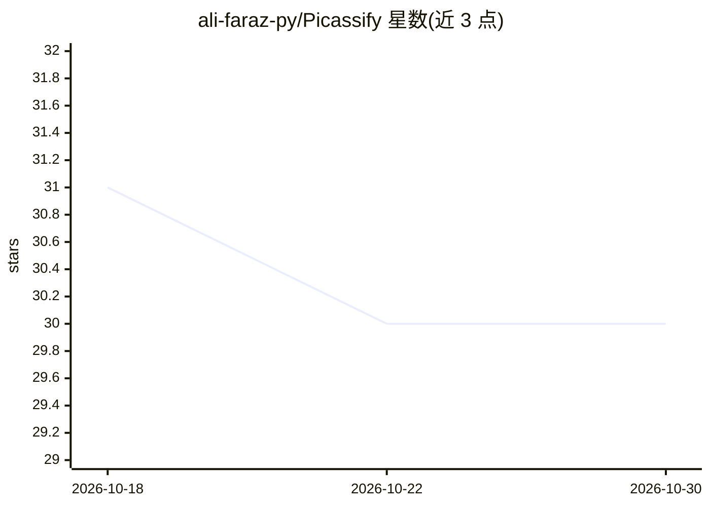

# ali-faraz-py/Picassify

⭐ 30 · Python · 推送 2026-09-17 · [GitHub](https://github.com/ali-faraz-py/Picassify) · [官网](https://picassify-art.streamlit.app/) · 个人维护

**给普通用户的神经风格迁移图像生成 Web 应用**

基于 Python 与 Streamlit 构建的神经风格迁移（NST）应用：实现 Gatys 等人算法，用预训练 VGG19 提取内容与风格特征，将照片与画作风格混合生成图像。提供可实时调节的风格/内容权重与优化步数，内置图像缩放与 ImageNet 标准化预处理。面向希望通过浏览器界面上传图片并生成艺术化图像的用户，通过 git clone 与 pip 安装依赖后以 streamlit run 本地运行，并有 Live Demo 链接。README 中未标明许可证。

## 筛选速览

| 维度 | 判定 | 备注 |
|---|---|---|
| AI 角色 | `ai-native` | 本体是模型或模型工具 |
| 许可风险 | `none` | — |
| 部署形态 | `library` | 以包/库形式分发 |
| 模型依赖 | — | README 未给出锁定关系 |
| 硬件要求 | — | 无带数字的原话,不猜 |
| 安装摩擦 | `low` | 无编译、无系统依赖或容器化 |
| 成熟度 | — | 结构信号不足 |

## 能力要点

- 实现 Gatys 等人神经风格迁移算法
- VGG19 预训练网络提取内容与风格特征
- 实时调节风格/内容权重比与优化步数
- Streamlit Web 界面，支持本地或云端运行

## 适用场景

- 上传照片与画作，生成风格迁移后的图像
- 调整权重与优化步数控制艺术效果
- 在本地浏览器中运行图像生成应用

## 场景标签

`图像生成` · 领域:内容生成

## 证据(README 行号)

> L3: A professional-grade Computer Vision dashboard built with **Python** and **Streamlit**. This tool utilizes **Neural 
> L9: - **Neural Style Transfer:** Implements the landmark Gatys et al. algorithm to decouple and recombine content and st

## 星数曲线

2026-10-18 31 → 2026-10-30 30（-1）

---
*卡片 v1 · prompt 1.4 · 生成 2026-10-26 · 置信度 high · 依据 README sha `9625960f47b5` · [字段定义](../../DATASET.md)*
