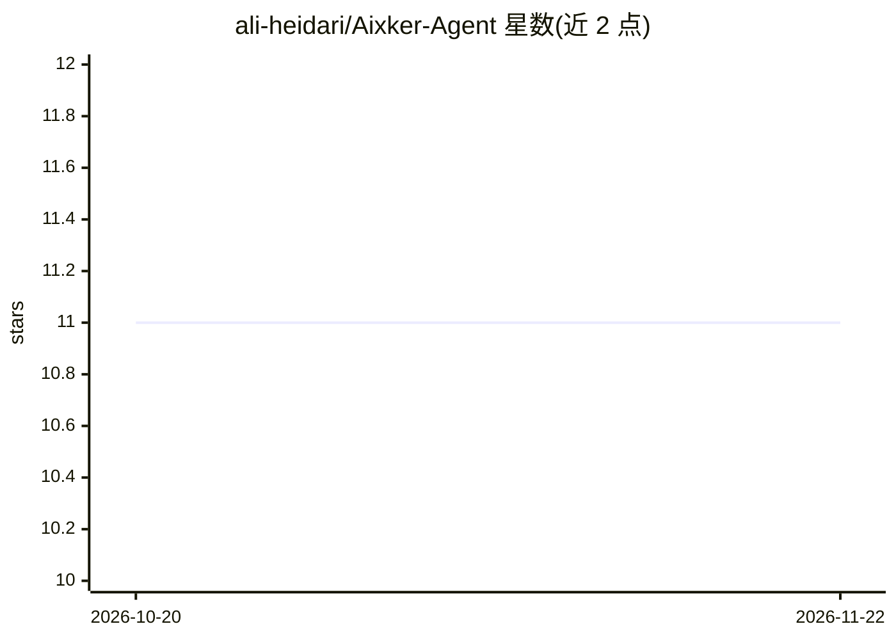

# ali-heidari/Aixker-Agent

⭐ 11 · Rust · Apache-2.0 · 推送 2026-06-09 · [GitHub](https://github.com/ali-heidari/Aixker-Agent) · [官网](https://aixker.com) · 个人维护

**给 Linux 节点提供内核级强化学习驱动的负载分流的 L4 负载均衡器**

用 Rust 编写的分布式 L4 负载均衡器：每个节点运行一个强化学习 agent（aixker_rlt），读取系统指标判定节点 FREE/BUSY 状态；过载时从集群中选取对等节点，写入 BPF map，由 XDP 程序在 NIC 层直接重定向新 TCP SYN，绕过用户态与 socket 缓冲。节点间通过 UDP 多播 gossip 自动发现，无中心注册表。README 提供 Docker 封装后端服务的部署流程、git clone + cargo build 的源码构建方式，以及 k6 基准测试脚本与对比数据。要求 Linux kernel ≥ 5.4 及多项 capabilities。

## 筛选速览

| 维度 | 判定 | 备注 |
|---|---|---|
| AI 角色 | `ai-ecosystem` | LLM/agent 周边工具 |
| 许可风险 | `permissive` | Apache-2.0 |
| 部署形态 | `self-host` | docker 或自建部署 |
| 模型依赖 | — | README 未给出锁定关系 |
| 硬件要求 | — | 无带数字的原话,不猜 |
| 安装摩擦 | `low` | 无编译、无系统依赖或容器化 |
| 成熟度 | — | 结构信号不足 |

## 能力要点

- RL agent 判定节点负载并选择重定向目标，决策在内核内、TCP 栈之前完成
- XDP/eBPF 内核旁路 NAT 引擎，在 NIC 层重定向新 TCP SYN
- UDP 多播 gossip 对等发现，无中心注册表与单点故障
- 提供 Docker 化部署流程与 k6 压测脚本

## 适用场景

- 给 Linux 上的后端服务节点做 L4 负载分流
- 在不增加独立代理节点的情况下组建自组织负载均衡集群
- 部署后用 k6 对集群做吞吐与延迟压测

## 场景标签

`强化学习` · 领域:训练与推理

## 证据(README 行号)

> L5: - A distributed AI-driven L4 load balancer written in Rust.
> L6: - Runs a reinforcement-learning agent on each node alongside an eBPF/XDP kernel-bypass NAT engine.
> L11: Each node runs one agent process. The RL model (`aixker_rlt`) reads system metrics and decides when the local node 

## 星数曲线

2026-10-20 11 → 2026-11-22 11（+0）

---
*卡片 v1 · prompt 1.4 · 生成 2026-11-18 · 置信度 mid · 依据 README sha `0cc423ddae1f` · [字段定义](../../DATASET.md)*
