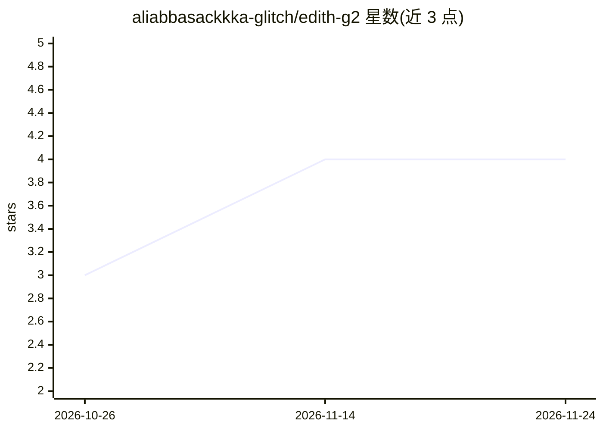

# aliabbasackkka-glitch/edith-g2

⭐ — · [GitHub]() · 个人维护

**自带 key 在 G2 眼镜/浏览器/PC 上与多家 AI 对话的客户端**

EDITH 是一个多端语音 AI 客户端：用户自带 API key 接入 Gemini、Groq、OpenAI、Claude、Grok、OpenRouter、DeepSeek、Mistral 或自建 OpenAI 兼容服务，通过 Even Realities G2 眼镜、网页或 PyQt6 桌面应用进行语音/文字问答，答案以流式文本显示并用所选厂商语音朗读。服务器部署在 Cloudflare Workers，含语音转写、网络搜索、记忆、聊天保存、实时字幕与翻译。EDITH 3 还可将眼镜桥接到本机运行的 Hermes Agent 或 OpenClaw，动作需在眼镜上点击批准。

## 筛选速览

| 维度 | 判定 | 备注 |
|---|---|---|
| AI 角色 | `ai-native` | 本体是模型或模型工具 |
| 许可风险 | `permissive` | — |
| 部署形态 | `library` | 以包/库形式分发 |
| 模型依赖 | local-ok | 支持本地模型 |
| 硬件要求 | — | 无带数字的原话,不猜 |
| 安装摩擦 | `low` | 无编译、无系统依赖或容器化 |
| 成熟度 | — | 结构信号不足 |

## 能力要点

- 自带 key 接入多家 AI，key 仅存于本设备/浏览器
- G2 眼镜、网页、PyQt6 桌面应用三种使用形态
- 桥接本机 Hermes Agent/OpenClaw，眼镜端批准操作
- 实时字幕与翻译、网络搜索、记忆、聊天保存等内置工具

## 适用场景

- 在 G2 眼镜上语音提问并把答案显示在镜片上
- 用不同厂商 key 在网页或 PC 上与多家 AI 对话并比较回答
- 将眼镜接入本机已运行的 AI agent 并远程批准其操作
- 对话场景下的实时字幕与翻译

## 场景标签

`AI 助手` `语音 Agent` · 领域:对话与助手

## 证据(README 行号)

> L3: **Talk to any AI, with your own key: on Even Realities G2 glasses, in your browser, or on your PC.**
> L13: Open **edith.starktech.workers.dev/web**, pick an AI,
> L110: - **Any AI, your key** (see the list). Groq (free and fast), Google Gemini (free), OpenAI, Anthropic Claude,

## 星数曲线

2026-10-26 3 → 2026-11-24 4（+1）

---
*卡片 v1 · prompt 1.4 · 生成 2026-11-21 · 置信度 high · 依据 README sha `32c0f5f43006` · [字段定义](../../DATASET.md)*
