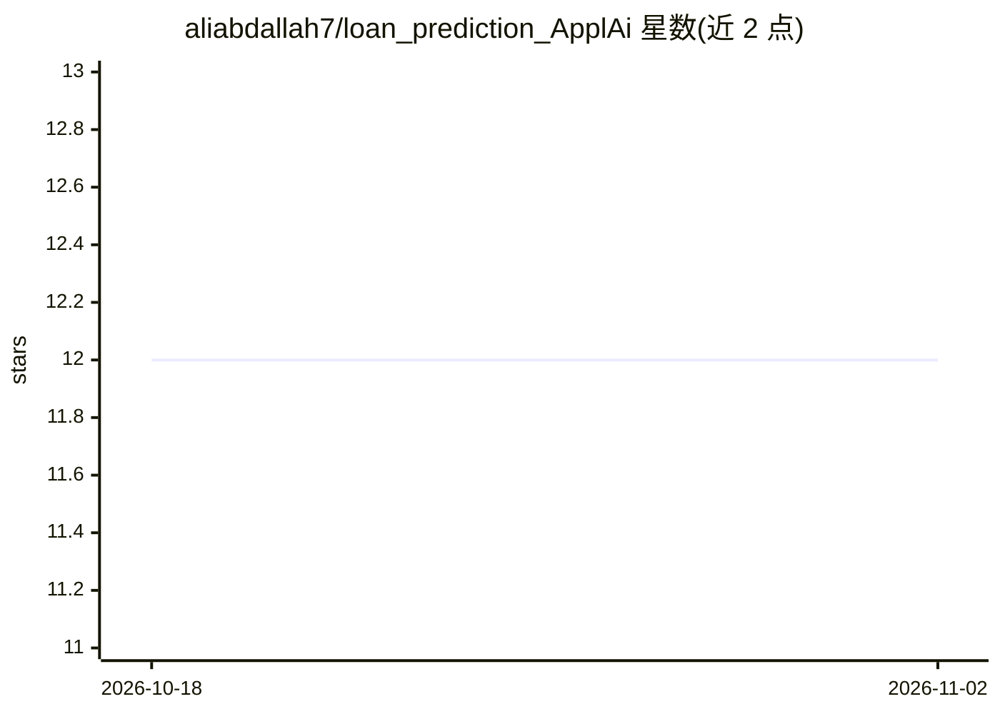

# aliabdallah7/loan_prediction_ApplAi

⭐ 12 · Jupyter Notebook · MIT · 推送 2026-08-29 · [GitHub](https://github.com/aliabdallah7/loan_prediction_ApplAi) · [官网](https://loanprediction.streamlit.app/) · 组织维护

**贷款申请接受/拒绝预测的 Streamlit 演示应用**

基于历史标注申请人数据（收入、信用记录、贷款金额等）训练多种经典机器学习分类器（逻辑回归、KNN、SVM、ID3 决策树、随机森林），最终采用逻辑回归模型部署为 Streamlit Web 应用，预测贷款申请是否被接受。提供 Docker Hub 预构建镜像、GitHub Actions CI/CD 流水线以及 Terraform + Azure Container Instances 的基础设施即代码部署。最初在 ApplAi（Ain Shams 大学学生社团）为期两周的机器学习工作坊中完成，附在线演示。

## 筛选速览

| 维度 | 判定 | 备注 |
|---|---|---|
| AI 角色 | `ai-native` | 本体是模型或模型工具 |
| 许可风险 | `permissive` | MIT |
| 部署形态 | `self-host` | docker 或自建部署 |
| 模型依赖 | — | README 未给出锁定关系 |
| 硬件要求 | — | 无带数字的原话,不猜 |
| 安装摩擦 | `low` | 无编译、无系统依赖或容器化 |
| 成熟度 | — | 结构信号不足 |

## 能力要点

- 评估 5 种经典分类器，生产采用逻辑回归模型
- Streamlit Web 应用，提供在线演示
- Docker Hub 预构建镜像与 GitHub Actions CI/CD
- Terraform 一键部署到 Azure Container Instances

## 适用场景

- 在浏览器中输入申请人信息查看贷款接受预测
- 学习 scikit-learn 分类模型评估与 Streamlit 部署流程
- 参考 Docker CI/CD 与 Terraform/Azure 部署实践

## 场景标签

 · 领域:金融/机器学习

## 证据(README 行号)

> L7: Predicts whether a loan application will be accepted or rejected, based on historical labeled applicant data (income
> L14: - Logistic Regression (final model used in production)

## 星数曲线

2026-10-18 12 → 2026-11-02 12（+0）

---
*卡片 v1 · prompt 1.4 · 生成 2026-11-01 · 置信度 high · 依据 README sha `5db68aa6c23c` · [字段定义](../../DATASET.md)*
