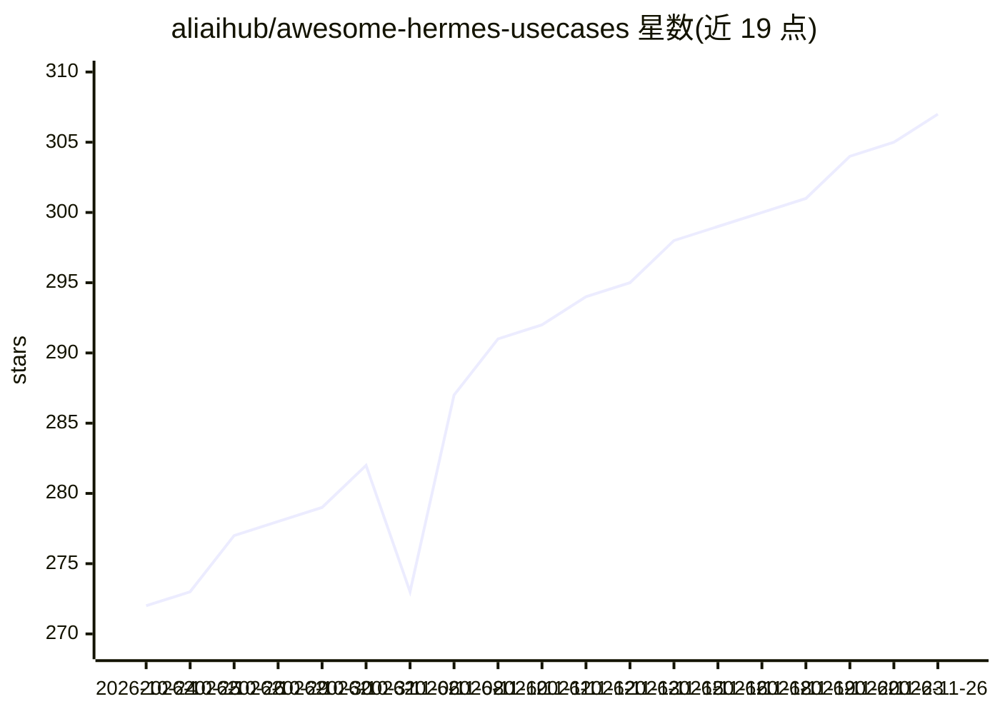

# aliaihub/awesome-hermes-usecases

⭐ 307 · Python · MIT · 推送 2026-10-25 · [GitHub](https://github.com/aliaihub/awesome-hermes-usecases) · 个人维护

**Hermes Agent 真实用例策展清单，附需求、设置与来源**

面向 Nous Research 的 Hermes Agent 的用例聚合清单：按业务管理、编码工程、内容营销、个人生产力、知识研究、家庭设备、基础设施安全等目标分类收录工作流，并单列托管与模型接入、界面集成、编排与 Agent 记忆等配置扩展条目。每个条目标注格式（本地演示/插件/技能/指南/案例研究等），页面含需求、设置、提示词与来源，并声明验证边界：格式标签不代表经过运行或审计。

## 筛选速览

| 维度 | 判定 | 备注 |
|---|---|---|
| AI 角色 | `ai-knowledge` | 知识聚合/清单类 |
| 许可风险 | `permissive` | MIT |
| 部署形态 | `None` |  |
| 模型依赖 | — | README 未给出锁定关系 |
| 硬件要求 | — | 无带数字的原话,不猜 |
| 安装摩擦 | `low` | 无编译、无系统依赖或容器化 |
| 成熟度 | — | 结构信号不足 |

## 能力要点

- 44+ 用例按 7 个目标类别与 3 个配置扩展类别组织
- 条目区分 Local demo/Plugin/Skill/Guide/Case study 等格式并声明验证限制
- 收录本地推理后端、企业网关（Bedrock/Azure/NVIDIA）与国内模型端点等接入指南
- 覆盖 K8s 编排、多 Agent 协作、技能自进化等进阶模式

## 适用场景

- 为 Hermes Agent 查找特定场景的工作流与配置方法
- 参考企业模型网关或国内模型端点的接入指南
- 了解 Agent 编排、记忆与技能自进化的实践模式

## 场景标签

`精选清单` · 领域:学习与行业

## 证据(README 行号)

> L3: # Awesome Hermes Agent Use Cases
> L13: Browse by the result you want, then open a page for requirements, setup, prompts, and sources. Public evidence and 
> L49: **Formats:** **Local demo** includes a starter in this repo; **Plugin**, **Skill**, and **Project** link to an impl

## 星数曲线

2026-10-24 272 → 2026-11-26 307（+35）

---
*卡片 v1 · prompt 1.4 · 生成 2026-11-25 · 置信度 high · 依据 README sha `23b70c682045` · [字段定义](../../DATASET.md)*
