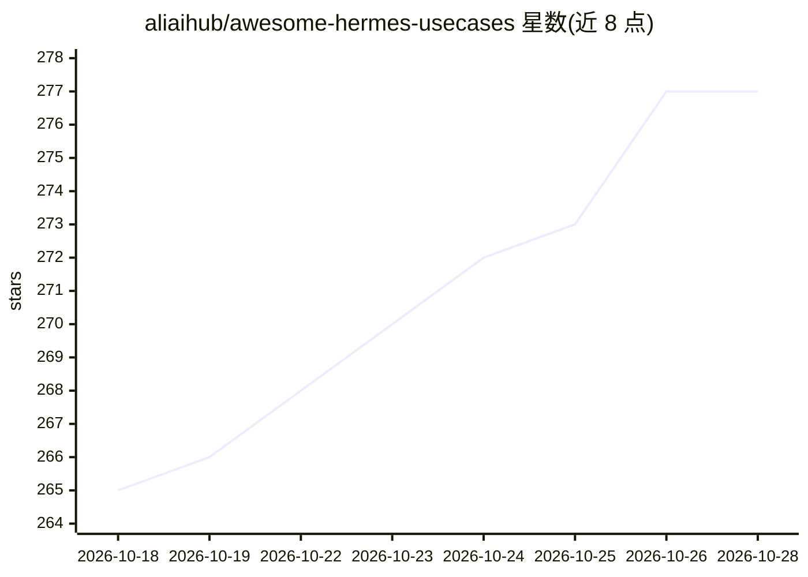

# aliaihub/awesome-hermes-usecases

⭐ 277 · Python · MIT · 推送 2026-10-25 · [GitHub](https://github.com/aliaihub/awesome-hermes-usecases) · 组织维护

**Hermes Agent 真实用例策展清单，每条附一手来源证据**

社区维护的 Hermes Agent（Nous Research 出品的自我改进 AI agent）真实用例合集，按自动化调度、消息机器人、编码工作流、多 agent 编排、记忆与上下文、可观测运维、安全测试等 14 个类别组织。收录规则要求每条用例链接到一手来源（官方文档、配套仓库、含部署细节的 issue 或第一人称博客），仅推文或营销页证据的条目放入 unverified 清单。提供 curl 安装 Hermes 的快速开始命令与 3 个可运行的示例工程。

## 筛选速览

| 维度 | 判定 | 备注 |
|---|---|---|
| AI 角色 | `ai-knowledge` | 知识聚合/清单类 |
| 许可风险 | `permissive` | MIT |
| 部署形态 | `self-host` | docker 或自建部署 |
| 模型依赖 | — | README 未给出锁定关系 |
| 硬件要求 | — | 无带数字的原话,不猜 |
| 安装摩擦 | `low` | 无编译、无系统依赖或容器化 |
| 成熟度 | — | 结构信号不足 |

## 能力要点

- 每条用例强制链接一手来源，弱证据条目隔离到 unverified 清单
- 覆盖 10+ 类别：自动化、团队机器人、编码、多 agent 编排、记忆、运维等
- /demos 提供 3 个可运行入门工程（Daily Briefing、Open WebUI、Team Telegram）

## 适用场景

- 寻找 Hermes Agent 在自动化、消息机器人、SRE 等场景的落地参考
- 按一手证据评估 agent 用例的真实性与部署细节
- 作为 agent 应用场景的调研素材库

## 场景标签

`精选清单` · 领域:学习与行业

## 证据(README 行号)

> L11: **A community collection of real-world Hermes Agent use cases — each one backed by public evidence.**
> L21: > **Evidence rule.** Every use case here links to a primary source: an official Hermes doc, a Nous Research compani

## 星数曲线

2026-10-18 265 → 2026-10-28 277（+12）

---
*卡片 v1 · prompt 1.4 · 生成 2026-10-22 · 置信度 mid · 依据 README sha `942655a1297d` · [字段定义](../../DATASET.md)*
