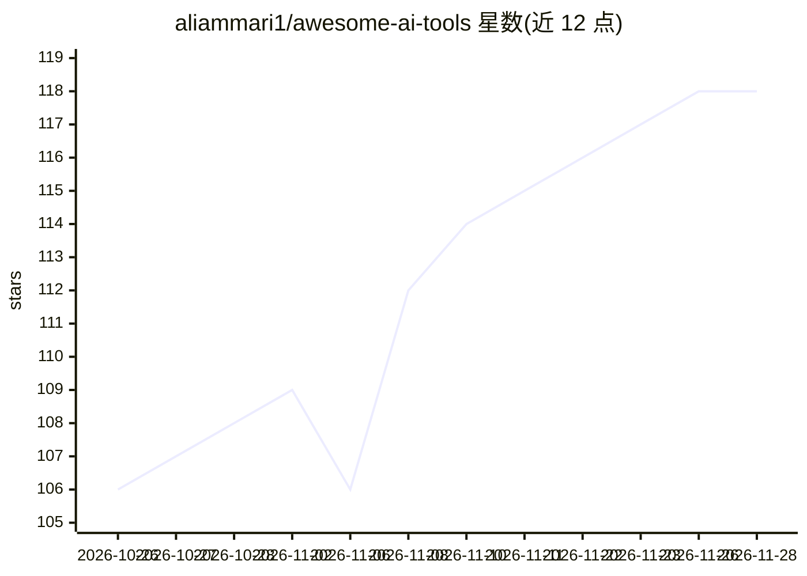

# aliammari1/awesome-ai-tools

⭐ 118 · TypeScript · CC0-1.0 · 推送 2026-11-08 · [GitHub](https://github.com/aliammari1/awesome-ai-tools) · [官网](https://docs.aliammari.dev) · 个人维护

**按19类整理的400+AI工具目录，供按任务查找选型**

以 awesome 清单形式组织的 AI 工具目录，条目按 AI Agents、Productivity、Creativity & Design、Communication & Writing 等 19 个类别分组，每条附一句功能描述与外链。README 声明可检索版目录托管在 docs.aliammari.dev，可按任务查找并比较已记录的定价与开源信息，未采集到的元数据保持空白。README 附安全声明：条目仅为第三方服务或仓库链接，列出不代表背书，并给出恶意链接举报渠道。目录维护依赖社区建议工具与公开的收录方法说明。

## 筛选速览

| 维度 | 判定 | 备注 |
|---|---|---|
| AI 角色 | `ai-knowledge` | 知识聚合/清单类 |
| 许可风险 | `viral` | CC0-1.0 |
| 部署形态 | `None` |  |
| 模型依赖 | — | README 未给出锁定关系 |
| 硬件要求 | — | 无带数字的原话,不猜 |
| 安装摩擦 | `low` | 无编译、无系统依赖或容器化 |
| 成熟度 | — | 结构信号不足 |

## 能力要点

- 400+ 条目按 19 个类别组织，覆盖 Agent 框架、生产力、设计、写作等领域
- 提供可检索在线目录，记录定价与开源信息
- 每条目附功能描述与第三方链接
- 附安全声明与恶意链接举报机制

## 适用场景

- 按任务类型查找可用的 AI 工具
- 比较同类工具的定价与是否开源
- 为工具目录提交或发现新条目

## 场景标签

`精选清单` · 领域:学习与行业

## 证据(README 行号)

> L3: > A curated catalog of **400+ AI tools** across **19 categories**.
> L6: Find AI tools by task, then compare recorded pricing and open-source information in the searchable directory. Unknow

## 星数曲线

2026-10-26 106 → 2026-11-28 118（+12）

---
*卡片 v1 · prompt 1.4 · 生成 2026-11-28 · 置信度 high · 依据 README sha `7ffe6755fe2b` · [字段定义](../../DATASET.md)*
