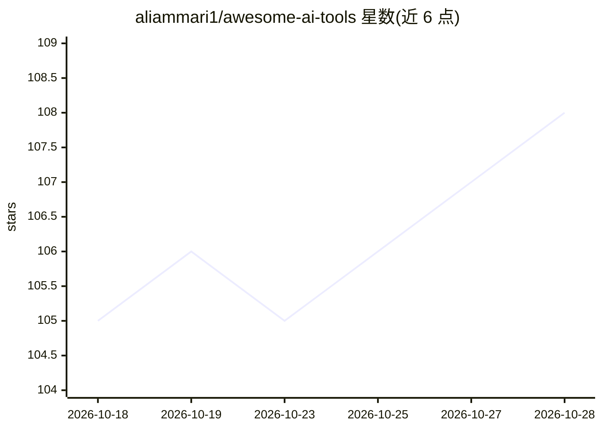

# aliammari1/awesome-ai-tools

⭐ 108 · JavaScript · CC0-1.0 · 推送 2026-10-26 · [GitHub](https://github.com/aliammari1/awesome-ai-tools) · [官网](https://docs.aliammari.dev) · 个人维护

**按任务分类的 384 个 AI 工具策展清单（19 类）**

以 awesome-list 形式组织的 AI 工具目录：收录 384 个工具，按 AI Agents、生产力、创意设计、写作沟通、数据科学、NLP、计算机视觉、音频音乐等 19 个类别分组，每个条目附一句话说明。配套可搜索目录站点 docs.aliammari.dev，支持按任务查找、对比定价与开源信息，未知元数据保留为未知；并给出收录方法与安全政策说明。条目混合商业 SaaS 与开源项目。

## 筛选速览

| 维度 | 判定 | 备注 |
|---|---|---|
| AI 角色 | `ai-knowledge` | 知识聚合/清单类 |
| 许可风险 | `viral` | CC0-1.0 |
| 部署形态 | `None` |  |
| 模型依赖 | — | README 未给出锁定关系 |
| 硬件要求 | — | 无带数字的原话,不猜 |
| 安装摩擦 | `low` | 无编译、无系统依赖或容器化 |
| 成熟度 | — | 结构信号不足 |

## 能力要点

- 384 个工具按 19 个类别组织
- 配套可搜索目录站点（docs.aliammari.dev），含定价与开源信息对比
- 声明收录方法（curation methodology）与安全政策

## 适用场景

- 按任务类别查找和对比 AI 工具
- 了解各领域 AI 工具的覆盖情况
- 通过目录站点检索定价与开源信息

## 场景标签

`精选清单` · 领域:学习与行业

## 证据(README 行号)

> L3: > A curated catalog of **384 AI tools** across **19 categories**.
> L6: Find AI tools by task, then compare recorded pricing and open-source information in the searchable directory. Unknow

## 星数曲线

2026-10-18 105 → 2026-10-28 108（+3）

---
*卡片 v1 · prompt 1.4 · 生成 2026-10-23 · 置信度 high · 依据 README sha `b6e309ae8690` · [字段定义](../../DATASET.md)*
