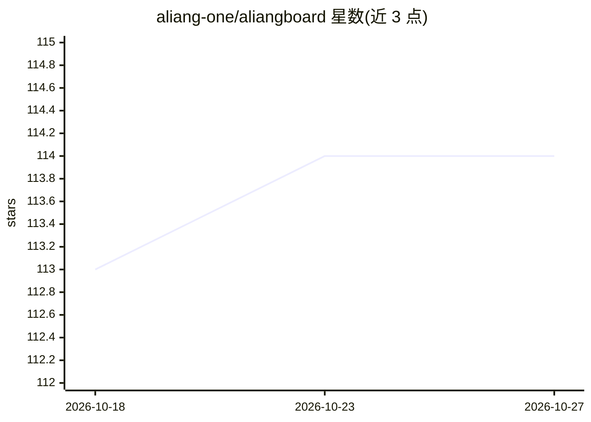

# aliang-one/aliangboard

⭐ 114 · JavaScript · Apache-2.0 · 推送 2026-10-25 · [GitHub](https://github.com/aliang-one/aliangboard) · 个人维护 · 中文 README

**面向 Kubernetes 运维的 AI 原生多集群管理面板，含 Agent 工作台与 MCP 服务器**

Vue 3 前端 + Node Kubernetes API 网关构成的自托管面板，覆盖多集群接入、30+ 资源全生命周期管理（Server-Side Apply）、exec 终端（tmux 支持刷新存活）、port-forward、debug 容器注入、节点运维与指标图表。AI 部分：内置 Agent 工作台经 ServiceAccount 分级调用 Kubernetes 工具（读免费、写操作需人工批准），同时以 Streamable HTTP MCP 服务器向 Claude Code 等外部 AI 客户端暴露同一工具集；LLM 通过 OpenAI 兼容协议接入。限制：SQLite 单副本不可横向扩缩，生产需边缘层 TLS 终止。

## 筛选速览

| 维度 | 判定 | 备注 |
|---|---|---|
| AI 角色 | `ai-enhanced` | 去掉 AI 部分产品仍成立 |
| 许可风险 | `permissive` | Apache-2.0 |
| 部署形态 | `self-host` | docker 或自建部署 |
| 模型依赖 | local-ok | 支持本地模型 |
| 硬件要求 | — | 无带数字的原话,不猜 |
| 安装摩擦 | `low` | 无编译、无系统依赖或容器化 |
| 成熟度 | — | 结构信号不足 |

## 能力要点

- Agent 工作台 + MCP 服务器（Streamable HTTP、API-key 认证）让 LLM 操作集群
- 工具分级 read/operator/admin，所有写操作经人工批准并记录审计日志
- 30+ 资源类型同步与 Server-Side Apply 结构化创建（20 种内置类型）
- exec 终端基于 tmux，页面刷新后存活

## 适用场景

- 用自然语言读日志、回滚发布、修改集群资源
- 自托管管理多个 Kubernetes 集群的完整资源生命周期
- 把集群工具集通过 MCP 接入 Claude Code 等外部 AI 客户端

## 场景标签

 · 领域:云原生/K8s 运维

## 证据(README 行号)

> L15: AliangBoard turns an LLM into an operator for your clusters: with the built-in **Agent workbench** and **MCP server
> L43: - Agent workbench + MCP server (Streamable HTTP, API-key auth)
> L55: - 30+ resource types synced; structured creation forms (20 built-in kinds) persisted via Server-Side Apply

## 星数曲线

2026-10-18 113 → 2026-10-27 114（+1）

---
*卡片 v1 · prompt 1.4 · 生成 2026-10-23 · 置信度 high · 依据 README sha `a49ec47f8100` · [字段定义](../../DATASET.md)*
