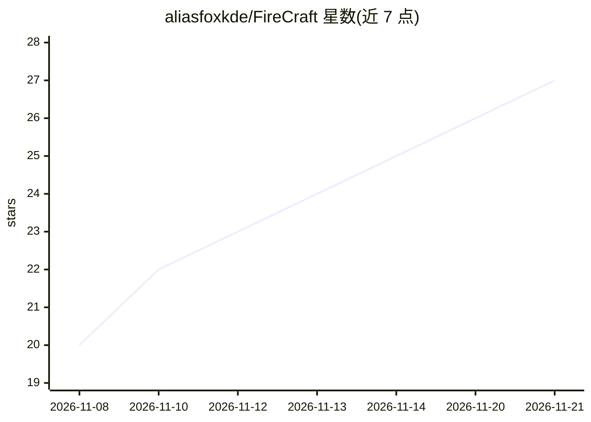

# aliasfoxkde/FireCraft

⭐ 27 · Rust · Apache-2.0 · 推送 2026-11-20 · [GitHub](https://github.com/aliasfoxkde/FireCraft) · [官网](https://artcraft-webos.pages.dev/) · 个人维护

**Rust 编写的开源矢量+位图混合图形编辑器，复刻 Fireworks 工作流**

用纯 Rust 实现的混合矢量与位图图形编辑器，目标是保留 Adobe Fireworks CS6 风格的工作流（矢量/位图编辑、分层文档、面向 Web 的导出）。核心是一个共享文档引擎与命令注册表（257 个注册命令），同一引擎驱动桌面应用、WebAssembly 版、CLI、脚本宿主与 MCP 服务器。支持读写 Fireworks PNG（.fw.png）及 PNG/JPEG/SVG/PSD 等格式导入导出。README 声明尚非功能完整的 Fireworks CS6 替代品，仍在活跃开发中。Linux x86_64 提供发布二进制与 Debian 包。

## 筛选速览

| 维度 | 判定 | 备注 |
|---|---|---|
| AI 角色 | `ai-enhanced` | 去掉 AI 部分产品仍成立 |
| 许可风险 | `permissive` | Apache-2.0 |
| 部署形态 | `None` |  |
| 模型依赖 | — | README 未给出锁定关系 |
| 硬件要求 | — | 无带数字的原话,不猜 |
| 安装摩擦 | `low` | 无编译、无系统依赖或容器化 |
| 成熟度 | `idea` | |

## 能力要点

- Fireworks PNG (.fw.png) 读写，保留未识别节点与块
- 共享命令注册表驱动桌面/WebAssembly/CLI/脚本/MCP 五种前端
- 257 个注册命令，CS6 DOM 对齐矩阵 268 carried / 3 partial / 0 missing
- ExtendScript 兼容 .jsf 脚本与 journal/replay 自动化

## 适用场景

- 用开源工具继续 Fireworks 风格的矢量与位图混合设计工作流
- 通过 CLI 或脚本批量转换/检查 .fw.png 文档
- 通过 MCP 服务器让 AI agent 驱动编辑器执行图形操作

## 场景标签

 · 领域:图形设计/桌面应用

## 证据(README 行号)

> L13: FireCraft is an independent, clean-room reimplementation of the hybrid vector-and-bitmap graphics editor workflow a
> L36: - **Automation:** a shared command registry, journal/replay, ExtendScript-compatible `.jsf` execution, headless CLI

## 星数曲线

2026-11-08 20 → 2026-11-21 27（+7）

---
*卡片 v1 · prompt 1.4 · 生成 2026-11-18 · 置信度 high · 依据 README sha `6d42536870cc` · [字段定义](../../DATASET.md)*
