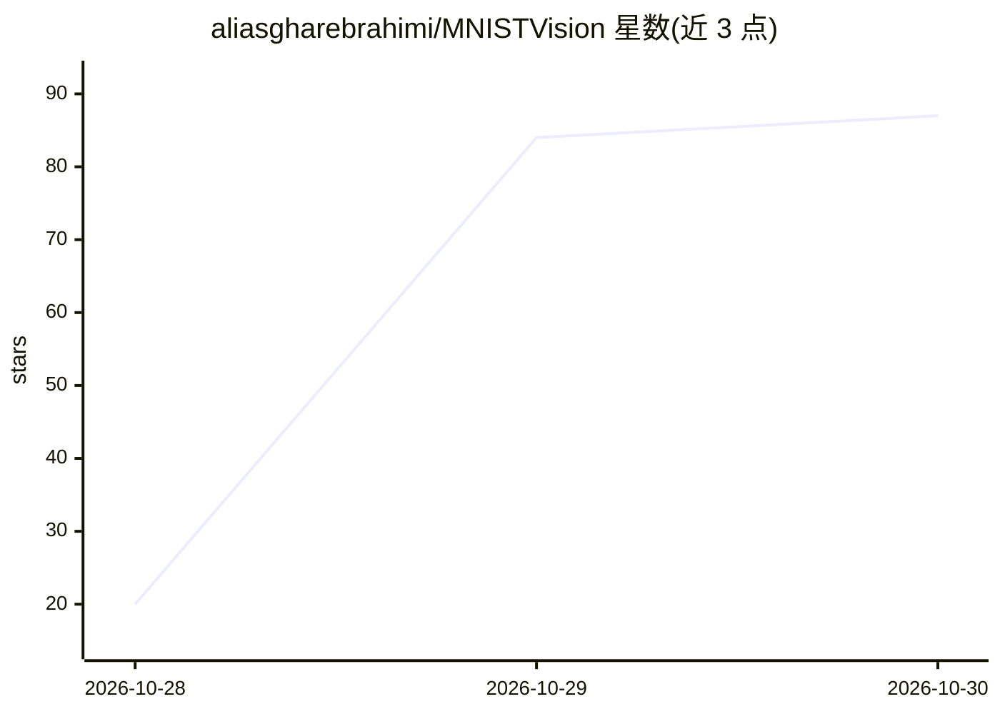

# aliasgharebrahimi/MNISTVision

⭐ 87 · Python · Apache-2.0 · 推送 2026-10-29 · [GitHub](https://github.com/aliasgharebrahimi/MNISTVision) · 个人维护

**研究者用的 MNIST 手写数字识别 PyTorch 模型**

基于 PyTorch 的手写数字识别项目：自设计的轻量 CNN（两个卷积块+全连接层，3,730 可训练参数，模型 0.11 MB），在 MNIST 测试集上取得 98% 准确率，训练+测试用时 52 秒。训练用 Adam 优化器与交叉熵损失，2 个 epoch、batch size 16，固定随机种子 42 保证可复现，实验通过 Weights & Biases 跟踪。以源码方式提供：git clone 后建虚拟环境、pip 安装依赖并运行 train_pipeline.py，MNIST 数据自动下载。作者自述局限：仅在 MNIST 上评估，未验证对更复杂图像分类任务的泛化。

## 筛选速览

| 维度 | 判定 | 备注 |
|---|---|---|
| AI 角色 | `ai-native` | 本体是模型或模型工具 |
| 许可风险 | `permissive` | Apache-2.0 |
| 部署形态 | `library` | 以包/库形式分发 |
| 模型依赖 | — | README 未给出锁定关系 |
| 硬件要求 | — | 无带数字的原话,不猜 |
| 安装摩擦 | `low` | 无编译、无系统依赖或容器化 |
| 成熟度 | — | 结构信号不足 |

## 能力要点

- 自设计轻量 CNN，3,730 参数、模型 0.11 MB，测试准确率 98%
- 固定随机种子（SEED=42）保证实验可复现
- 使用 W&B 进行实验与超参数调优跟踪

## 适用场景

- 作为 PyTorch 图像分类入门/教学示例运行
- 在 MNIST 上复现训练与评估流程
- 参考轻量 CNN 架构与实验跟踪实践

## 场景标签

`教程课程` · 领域:学习与行业

## 证据(README 行号)

> L3: > A handwritten digit recognition model featuring robust optimization, very high speed and accuracy, and an architec
> L9: This project focuses on developing an optimized deep learning model for handwritten digit recognition, with an empha
> L189: MNISTVision uses a custom convolutional neural network designed for handwritten digit classification.

## 星数曲线

2026-10-28 20 → 2026-10-30 87（+67）

---
*卡片 v1 · prompt 1.4 · 生成 2026-10-28 · 置信度 mid · 依据 README sha `3f615436e6d6` · [字段定义](../../DATASET.md)*
