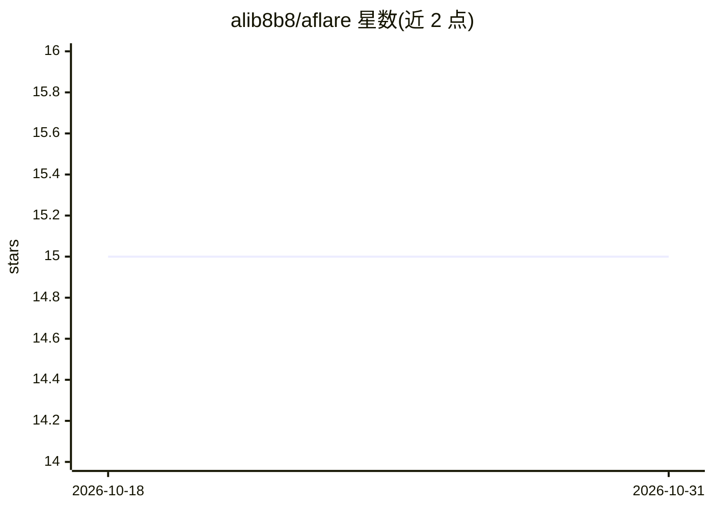

# alib8b8/aflare

⭐ 15 · Go · NOASSERTION · 推送 2026-10-03 · [GitHub](https://github.com/alib8b8/aflare) · [官网](https://github.com/alib8b8/aflare) · 个人维护 · 中文 README

**本地优先的自动化 Agent 与确定性工作流引擎**

以单个 Go 二进制提供对话式 ReAct Agent 与 YAML 工作流引擎：DAG 并行调度（TLA+ 形式化验证）、WAL 崩溃恢复、Saga 补偿、幂等与重试限流熔断。用户显式授权目录、笔记库、本地数据库等连接器（files/notes/sqlite/mysql/postgres/http），凭据存于本地加密 secrets 存储。支持接入自有 LLM（Ollama/vLLM/LM Studio/OpenAI 兼容端点，含 OpenRouter 与按成本/延迟路由），无 LLM 时用关键词匹配离线运行。面向本地用户与 CI（GitHub Action），采用 AGPL + 商业双许可。

## 筛选速览

| 维度 | 判定 | 备注 |
|---|---|---|
| AI 角色 | `ai-ecosystem` | LLM/agent 周边工具 |
| 许可风险 | `none` | NOASSERTION |
| 部署形态 | `self-host` | docker 或自建部署 |
| 模型依赖 | local-ok | 支持本地模型 |
| 硬件要求 | — | 无带数字的原话,不猜 |
| 安装摩擦 | `low` | 无编译、无系统依赖或容器化 |
| 成熟度 | — | 结构信号不足 |

## 能力要点

- DAG 调度 + WAL 恢复 + Saga 补偿的确定性执行运行时
- 本地优先：数据留在本地磁盘，离线可用，无使用遥测
- 显式授权的连接器体系（files/notes/sqlite/mysql/postgres/http）
- HMAC 审计链、AES-GCM 加密 secrets、L0–L3 四级安全模式

## 适用场景

- 在本地机器上用自然语言 Agent 操作自己的文件、笔记和数据库
- 编排可恢复、可审计的自动化工作流并接入自选 LLM
- 在 CI 中以 GitHub Action 步骤运行 aflare 工作流

## 场景标签

`工作流自动化` `Agent 框架` · 领域:Agent 开发

## 证据(README 行号)

> L75: A **local-first automation Agent** and a **deterministic workflow engine** in a single binary. You explicitly grant
> L85: Currently at **v0.12.0**, targeting local users first — local data lives on your machine, aflare is the determinist
> L90: - **Connect your own LLM** — Ollama / vLLM / LM Studio / any OpenAI-compatible endpoint; loopback needs no API key;

## 星数曲线

2026-10-18 15 → 2026-10-31 15（+0）

---
*卡片 v1 · prompt 1.4 · 生成 2026-10-30 · 置信度 mid · 依据 README sha `57ec14618e24` · [字段定义](../../DATASET.md)*
