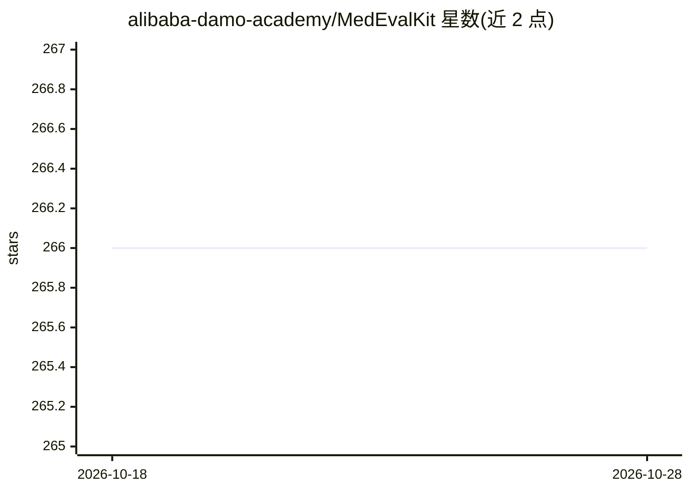

# alibaba-damo-academy/MedEvalKit

⭐ 266 · Python · 推送 2026-02-24 · [GitHub](https://github.com/alibaba-damo-academy/MedEvalKit) · [官网](https://alibaba-damo-academy.github.io/lingshu/) · 组织维护 · 中文 README

**面向医疗大模型（LMM/LLM）的统一评测框架**

阿里巴巴达摩院医疗 AI 团维护的医疗领域模型评测框架：支持多模态与纯文本两类医疗基准，共 20 余个数据集（MedQA-USMLE、MedMCQA、PubMedQA、PMC_VQA、MIMIC-CXR、CMB、CMMLU 等），并支持 HuggingFace 独占及 HF+vLLM 兼容的约 14 种医疗/通用多模态模型。通过克隆仓库、配置 eval.sh 后运行脚本执行评测；部分数据集需手动下载，支持 hf-mirror 镜像端点。随附 Lingshu 医疗基础模型相关 arXiv 论文。

## 筛选速览

| 维度 | 判定 | 备注 |
|---|---|---|
| AI 角色 | `ai-ecosystem` | LLM/agent 周边工具 |
| 许可风险 | `none` | — |
| 部署形态 | `None` |  |
| 模型依赖 | local-ok | 支持本地模型 |
| 硬件要求 | — | 无带数字的原话,不猜 |
| 安装摩擦 | `low` | 无编译、无系统依赖或容器化 |
| 成熟度 | — | 结构信号不足 |

## 能力要点

- 覆盖多模态与纯文本共 20+ 医疗基准数据集
- 支持 HuggingFace 独占模型与 HF+vLLM 兼容模型共 14 种
- eval.sh 一键运行多基准评测，支持 HF 镜像端点
- 数据集支持 HuggingFace 直连与本地手动下载两种方式

## 适用场景

- 对医疗多模态/语言模型在标准医疗基准上做评测
- 对比不同医疗模型在国内外（USMLE/CMB/CMMLU）基准的表现
- 复现 Lingshu 系列模型的评测结果

## 场景标签

`模型评测` · 领域:评测与运维

## 证据(README 行号)

> L18: A comprehensive evaluation framework for **Large Medical Models (LMMs/LLMs)** in the healthcare domain.
> L67: ### HF + vLLM Compatible

## 星数曲线

2026-10-18 266 → 2026-10-28 266（+0）

---
*卡片 v1 · prompt 1.4 · 生成 2026-10-22 · 置信度 high · 依据 README sha `12f6341d278d` · [字段定义](../../DATASET.md)*
