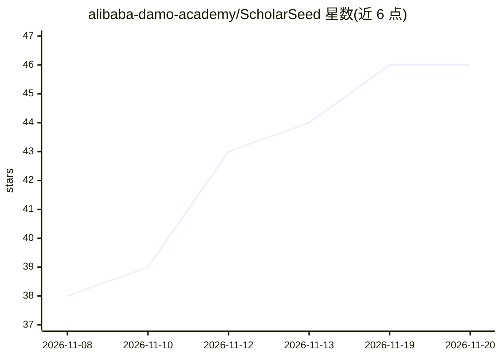

# alibaba-damo-academy/ScholarSeed

⭐ 46 · Python · Apache-2.0 · 推送 2026-11-19 · [GitHub](https://github.com/alibaba-damo-academy/ScholarSeed) · [官网](https://scholarseed.damo.alibaba.com/) · 组织维护 · 中文 README

**本地优先的 AI 原生科研工作台：文献检索、阅读、验证与写作**

Electron 桌面研究应用，围绕同一研究项目串联 PDF 阅读、文献库、对话问答与写作输出。提供证据链引用的可检验回答、结构化文献综述生成（Markdown/LaTeX/PDF）、基于 SKILL.md 的可复用研究工作流（Skills）与插件/MCP 扩展机制。本地 SQLite 存储数据，模型按会话切换，支持 Qwen/OpenAI/Anthropic/DeepSeek 等及任意 OpenAI 兼容端点。面向科研用户；插件与部分接口处于 developer preview。

## 筛选速览

| 维度 | 判定 | 备注 |
|---|---|---|
| AI 角色 | `ai-native` | 本体是模型或模型工具 |
| 许可风险 | `permissive` | Apache-2.0 |
| 部署形态 | `None` |  |
| 模型依赖 | locked-api |  |
| 硬件要求 | — | 无带数字的原话,不猜 |
| 安装摩擦 | `low` | 无编译、无系统依赖或容器化 |
| 成熟度 | `idea` | |

## 能力要点

- 引用回溯至来源与原文段落的可检验 AI 回答
- 内置 11 个 Skill 的研究工作流（文献检索、综述、想法探索等）
- 本地优先：SQLite 存储、代理隔离运行、按目录授权
- 按 SKILL.md 定义研究方法，可扩展插件与 MCP 连接器

## 适用场景

- 整理文献库并对论文做选段解释、翻译与方法分析
- 从研究问题出发发现文献并生成带引用的文献综述
- 把实验室的阅读与分析方法固化为可复用 Skill

## 场景标签

`知识库管理` `科研工具` `文档问答` · 领域:知识与检索

## 证据(README 行号)

> L10:  Search, read, ask, verify, and build, with your own models, using your own skills and plugins, on your own machine
> L51: **4. Read and ask** — Open the PDF, select a passage, and use **Explain** or **Translate**. Add relevant papers, no
> L95: - Use `literature-review` to develop a structured review with evidence processing and review checkpoints.

## 星数曲线

2026-11-08 38 → 2026-11-20 46（+8）

---
*卡片 v1 · prompt 1.4 · 生成 2026-11-18 · 置信度 high · 依据 README sha `b7dac1aae018` · [字段定义](../../DATASET.md)*
