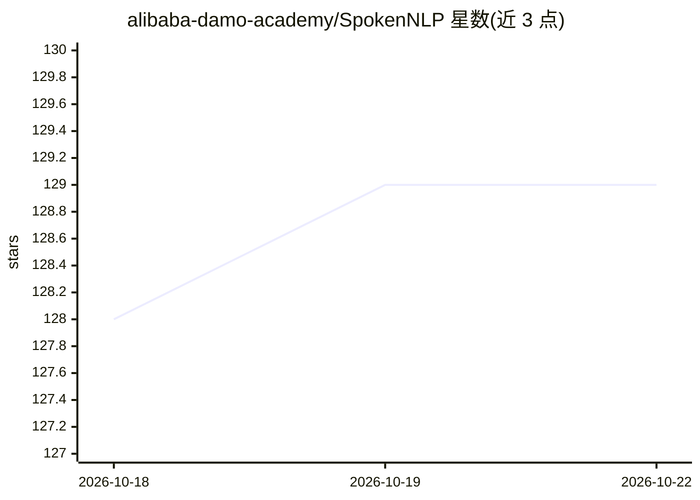

# alibaba-damo-academy/SpokenNLP

⭐ 129 · Python · Apache-2.0 · 推送 2026-03-11 · [GitHub](https://github.com/alibaba-damo-academy/SpokenNLP) · 组织维护 · 中文 README

**阿里达摩院语音实验室 SpokenNLP 团队的研究代码集合**

阿里达摩院 Speech Lab SpokenNLP 团队的官方代码库，汇集该团队历年研究项目：包括中文授课视频话题分割的多模态模型 MMVTS、离散 token ASR 的 SLD、免训练句向量方法 Ditto、长序列 token 混合网络 PoNet、无监督关键短语抽取 MDERank、口语文档分割 SeqModel、JointBERT 等，多数发表于 ACL/EMNLP/ICASSP/ICLR 等会议。部分模型发布于 Hugging Face 与 Modelscope。以 Python/PyTorch 代码形式提供，Apache 2.0 许可。

## 筛选速览

| 维度 | 判定 | 备注 |
|---|---|---|
| AI 角色 | `ai-native` | 本体是模型或模型工具 |
| 许可风险 | `permissive` | Apache-2.0 |
| 部署形态 | `None` |  |
| 模型依赖 | — | README 未给出锁定关系 |
| 硬件要求 | — | 无带数字的原话,不猜 |
| 安装摩擦 | `low` | 无编译、无系统依赖或容器化 |
| 成熟度 | — | 结构信号不足 |

## 能力要点

- 收录 MMVTS/SLD/Ditto/PoNet/MDERank/SeqModel 等十余个研究项目
- PoNet、SeqModel 等模型发布于 Modelscope（中英文）
- PoNet 提交至 Hugging Face hub，可经 Transformers 库直接使用
- 发布 Wiki-zh 中文文档分割数据集与 MUG 挑战赛基线系统

## 适用场景

- 复现或参考口语语言处理方向的论文方法
- 获取长序列建模、文档分割、句向量等预训练模型
- 参加或研究会议理解与生成（MUG）挑战赛基线

## 场景标签

 · 领域:语音/NLP 研究

## 证据(README 行号)

> L3: **SpokenNLP: The official repository for codebases on a wide variety of research projects developed by the SpokenNLP
> L6: - [**2025-05-16**]: `MMVTS` was accepted by ACL 2025 Findings. It introduces a dataset for topic segmentation of Chi

## 星数曲线

2026-10-18 128 → 2026-10-22 129（+1）

---
*卡片 v1 · prompt 1.4 · 生成 2026-10-22 · 置信度 mid · 依据 README sha `bdfeac75c14b` · [字段定义](../../DATASET.md)*
