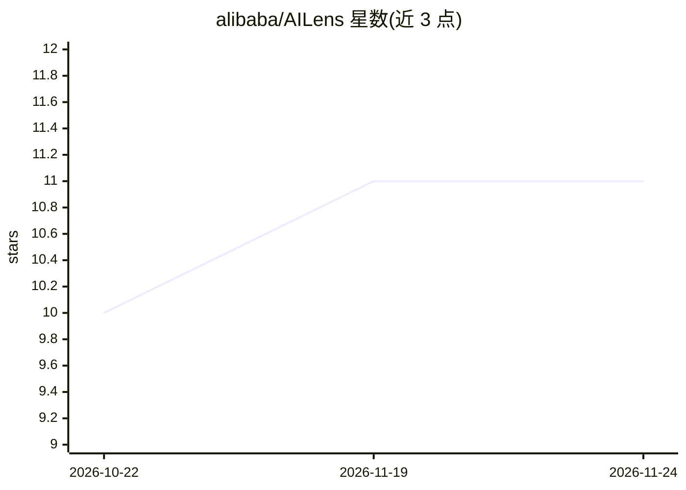

# alibaba/AILens

⭐ 11 · Python · NOASSERTION · 推送 2026-04-30 · [GitHub](https://github.com/alibaba/AILens) · 组织维护 · 中文 README

**AI 训练与生产系统的全栈可观测性平台**

面向 AI agent 训练与生产系统的开源可观测性平台，当前聚焦端到端 RL 后训练监控：实验管理（pass rate、reward、token 用量等指标）、任务与工具调用分析、多维过滤的轨迹探索与逐轮回放、数据集仪表盘，以及基于 OpenTelemetry/TraceQL 的 agent trace 查询。架构为 React 前端 + Python FastAPI 后端 + Java 网关 + ClickHouse，通过 OTel Collector 接收轨迹与 trace 数据。提供 Docker Compose 一键部署和本地开发两种运行方式，内置示例数据。

## 筛选速览

| 维度 | 判定 | 备注 |
|---|---|---|
| AI 角色 | `ai-ecosystem` | LLM/agent 周边工具 |
| 许可风险 | `none` | NOASSERTION |
| 部署形态 | `self-host` | docker 或自建部署 |
| 模型依赖 | — | README 未给出锁定关系 |
| 硬件要求 | — | 无带数字的原话,不猜 |
| 安装摩擦 | `low` | 无编译、无系统依赖或容器化 |
| 成熟度 | — | 结构信号不足 |

## 能力要点

- RL 训练实验管理：收敛曲线、reward 分布、分语言/类别 pass rate
- 轨迹逐轮回放与多维过滤（Outcome/Iteration/Reward/Turns 等）定位失败根因
- 基于 OpenTelemetry 的 agent trace 查询（TraceQL + Span Waterfall）
- HarborSDK 导出日志自动投影为 rl_traces 视图

## 适用场景

- 监控 RL 后训练流水线中的实验与任务表现
- 回放并分析失败轨迹，定位训练瓶颈
- 对 agent 服务的调用链进行 trace 检索与分析

## 场景标签

`LLM 可观测性` `MLOps` · 领域:评测与运维

## 证据(README 行号)

> L28: **AI Lens** is an open-source observability platform for AI agent training and production systems. It provides end-
> L47: - **Trace Search** — OpenTelemetry-based agent trace query via TraceQL with Span Waterfall view

## 星数曲线

2026-10-22 10 → 2026-11-24 11（+1）

---
*卡片 v1 · prompt 1.4 · 生成 2026-11-19 · 置信度 high · 依据 README sha `eaebf6e929d2` · [字段定义](../../DATASET.md)*
