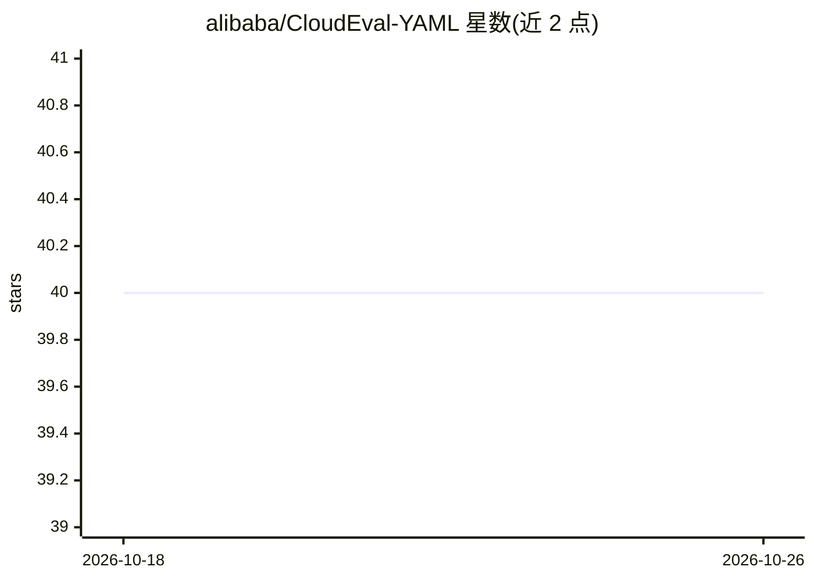

# alibaba/CloudEval-YAML

⭐ 40 · Python · MIT · 推送 2026-09-10 · [GitHub](https://github.com/alibaba/CloudEval-YAML) · 组织维护

**云原生 YAML 配置生成的大模型基准测试（1011 题）**

面向云原生场景的 LLM 实用基准：收录 1011 道题目，覆盖 Kubernetes、Envoy、Istio 等常见部署应用的配置生成，每题包含手写问题上下文、参考 YAML 文件与单元测试脚本。提供 Python 脚本运行评测，指标含 BLEU、编辑距离与单元测试；内置 OpenAI GPT-3.5/4、Google PaLM 2 与 Replicate 平台开源模型（llama-2 等）的接入配置。单元测试需在指定 AWS EC2 AMI 环境运行，耗时数小时。

## 筛选速览

| 维度 | 判定 | 备注 |
|---|---|---|
| AI 角色 | `ai-knowledge` | 知识聚合/清单类 |
| 许可风险 | `permissive` | MIT |
| 部署形态 | `library` | 以包/库形式分发 |
| 模型依赖 | — | README 未给出锁定关系 |
| 硬件要求 | — | 无带数字的原话,不猜 |
| 安装摩擦 | `low` | 无编译、无系统依赖或容器化 |
| 成熟度 | — | 结构信号不足 |

## 能力要点

- 1011 道覆盖 Kubernetes/Envoy/Istio 的配置生成题目
- 每题含手写上下文、参考 YAML 与单元测试脚本
- 支持 OpenAI GPT、PaLM 2、Replicate 多模型评测对比
- 输出 BLEU/编辑距离/单元测试等指标并保存至 outputs/

## 适用场景

- 选型前对比不同 LLM 生成云原生配置的能力
- 评估不同采样与提示工程技术的效果
- 复现云配置生成领域的基准测试结果

## 场景标签

`模型评测` · 领域:评测与运维

## 证据(README 行号)

> L7: 📊 The table is generated with CloudEval-YAML, a practical Large Language Model (LLM) benchmark specifically designed
> L9: *CloudEval-YAML: A Practical Benchmark for Cloud Native YAML Configuration Generation*.

## 星数曲线

2026-10-18 40 → 2026-10-26 40（+0）

---
*卡片 v1 · prompt 1.4 · 生成 2026-10-25 · 置信度 high · 依据 README sha `b4378aa2d179` · [字段定义](../../DATASET.md)*
