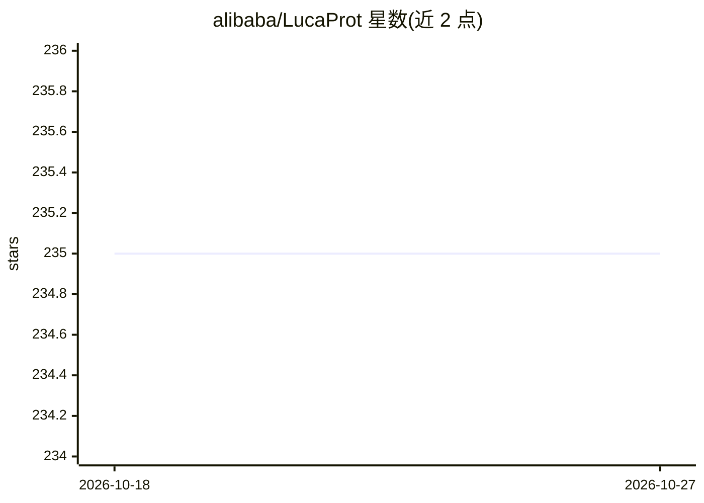

# alibaba/LucaProt

⭐ 235 · Python · Apache-2.0 · 推送 2026-01-29 · [GitHub](https://github.com/alibaba/LucaProt) · [官网](https://www.cell.com/cell/fulltext/S0092-8674(24)01085-7) · 组织维护 · 中文 README

**蛋白质功能预测深度学习框架，应用于病毒 RdRP 识别**

阿里巴巴开源的深度学习模型（DeepProtFunc/LucaProt），融合蛋白质氨基酸序列与结构信息进行功能预测，模型含输入、Tokenizer、编码器、Pooling、输出五个模块。主要应用为病毒 RdRP（RNA 依赖 RNA 聚合酶）识别（二分类），也支持多标签功能注释。提供单序列、fasta 批量与预存嵌入文件三种推理路径，兼容 Linux/macOS/Windows，支持 CPU 与 GPU 推理；附带基于 Flask 的 Web 应用、后处理流程（将预测 RdRP 归入 180 个超群）及训练数据集。依赖 Python 3.9、PyTorch 1.13.1，CUDA 为可选（cuda11.7）。

## 筛选速览

| 维度 | 判定 | 备注 |
|---|---|---|
| AI 角色 | `ai-native` | 本体是模型或模型工具 |
| 许可风险 | `permissive` | Apache-2.0 |
| 部署形态 | `None` |  |
| 模型依赖 | — | README 未给出锁定关系 |
| 硬件要求 | — | 无带数字的原话,不猜 |
| 安装摩擦 | `medium` | 含编译或系统依赖之一 |
| 成熟度 | — | 结构信号不足 |

## 能力要点

- 融合蛋白质序列与结构信息的深度学习模型，用于功能预测/分类
- 提供单序列、fasta 批量、预存嵌入文件三种推理方式，支持 CPU/GPU
- 基于 Flask 的可部署 Web 应用（src/app/）
- 提供训练数据集（正例 5,979 / 负例 229,434）与 11 个独立验证数据集性能数据

## 适用场景

- 对未知蛋白质序列做病毒 RdRP 识别
- 将预测出的 RdRP 分类到已知或新型超群
- 通过 Web 界面提交序列进行蛋白功能预测

## 场景标签

`科研工具` · 领域:学习与行业

## 证据(README 行号)

> L29: **LucaProt**: A novel deep learning framework that incorporates protein amino acid sequence and structural informat
> L37: Here, we applied LucaProt to identify viral RdRP.
> L47: Use the amino acid letter sequence as the input of our model. The model outputs the function label of the input pro

## 星数曲线

2026-10-18 235 → 2026-10-27 235（+0）

---
*卡片 v1 · prompt 1.4 · 生成 2026-10-22 · 置信度 high · 依据 README sha `a98de281c254` · [字段定义](../../DATASET.md)*
