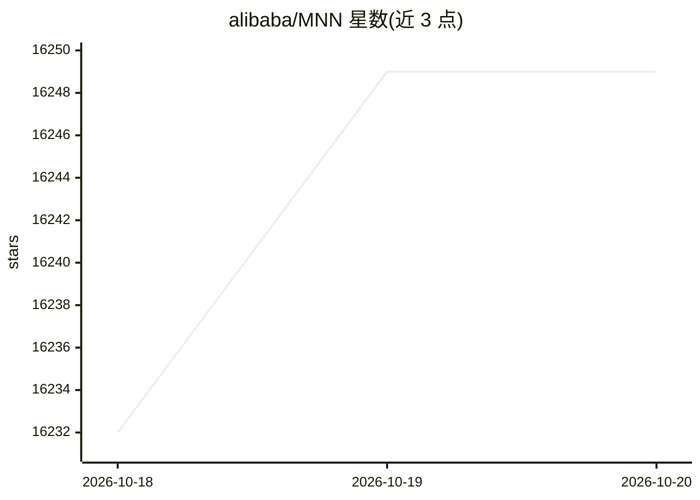

# alibaba/MNN

⭐ 16,249 · C++ · Apache-2.0 · 推送 2026-10-19 · [GitHub](https://github.com/alibaba/MNN) · 组织维护 · 中文 README

**面向开发者的端侧深度学习推理与训练框架，支持本地部署 LLM 与扩散模型**

MNN 是一个轻量级深度学习框架，支持深度学习模型的推理与训练，已被集成进阿里巴巴 30 多个应用（淘宝、天猫、优酷、钉钉等）及 IoT 嵌入式设备。基于该引擎提供 MNN-LLM 端侧大模型运行时（覆盖手机/PC/IoT）与 MNN-Diffusion 稳定扩散运行时；附带模型转换、压缩、训练、CV 等工具链，支持 Tensorflow/Caffe/ONNX/Torchscript 模型转换与 FP16/Int8 量化，通过 Metal/OpenCL/Vulkan/CUDA 支持 GPU 推理。

## 筛选速览

| 维度 | 判定 | 备注 |
|---|---|---|
| AI 角色 | `ai-ecosystem` | LLM/agent 周边工具 |
| 许可风险 | `permissive` | Apache-2.0 |
| 部署形态 | `None` |  |
| 模型依赖 | — | README 未给出锁定关系 |
| 硬件要求 | — | 无带数字的原话,不猜 |
| 安装摩擦 | `medium` | 含编译或系统依赖之一 |
| 成熟度 | — | 结构信号不足 |

## 动量与使用信号

- 维护:`active` — 距上次 push 2.1 天,年发版 6,191 位贡献者
- 涨星:近 1 天 **+5**(自 20261016 起算)
- 下载:GitHub Release 附件 累计 77,819(63 个 release)
- 平台:ANDROID / IOS · 协议:—

## 能力要点

- MNN-LLM 支持在手机/PC/IoT 上本地部署大语言模型（含 Qwen、LLAMA 等）
- 支持 Tensorflow/Caffe/ONNX/Torchscript 模型转换（合计数百个 OP）与 FP16/Int8 量化
- 通过 Metal/OpenCL/Vulkan/CUDA 支持 GPU 推理，另含 Hexagon DSP 后端
- 提供 MNN-LLM Android/iOS 多模态应用及 TaoAvatar、Sana 等衍生应用

## 适用场景

- 在 Android/iOS 设备上离线运行大语言模型与多模态模型
- 将 Tensorflow/ONNX 等框架训练的模型转换部署到移动端或嵌入式设备
- 在端侧本地运行稳定扩散图像生成与 3D 数字人对话

## 场景标签

`推理引擎` `模型量化` `图像生成` · 领域:内容生成

## 证据(README 行号)

> L60: MNN is a highly efficient and lightweight deep learning framework. It supports inference and training of deep learn
> L62: MNN-LLM is a large language model runtime solution developed based on the MNN engine. The mission of this project i
> L90: ## Key Features

## 星数曲线

2026-10-18 16,232 → 2026-10-20 16,249（+17）

---
*卡片 v1 · prompt 1.4 · 生成 2026-10-18 · 置信度 high · 依据 README sha `8b3f12779ac0` · [字段定义](../../DATASET.md)*
