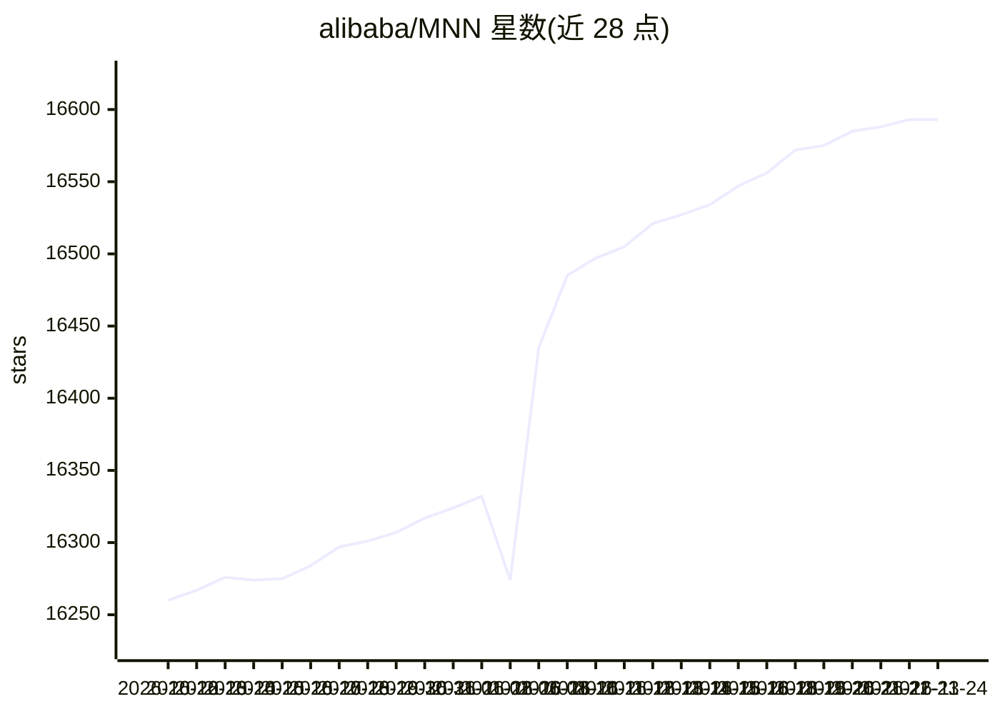

# alibaba/MNN

⭐ 16,608 · C++ · Apache-2.0 · 推送 2026-11-23 · [GitHub](https://github.com/alibaba/MNN) · 组织维护 · 中文 README

**面向移动/嵌入式设备的轻量深度学习推理与训练引擎**

MNN 是一个轻量级深度学习框架，支持模型推理与训练，README 称已集成于阿里 30 余款 App。基于该引擎提供多个运行时方案：MNN-LLM 用于在手机/PC/IoT 本地部署大语言模型，MNN-Diffusion 用于本地部署稳定扩散模型。配套工具包括模型转换器（Tensorflow/Caffe/ONNX/Torchscripts）、模型压缩、通用计算、轻量图像处理与训练模块。支持 CPU 多架构与 GPU 后端（Metal/OpenCL/Vulkan/CUDA）及 NPU 路径，提供 Python API 与 MNN Workbench。

## 筛选速览

| 维度 | 判定 | 备注 |
|---|---|---|
| AI 角色 | `ai-ecosystem` | LLM/agent 周边工具 |
| 许可风险 | `permissive` | Apache-2.0 |
| 部署形态 | `None` |  |
| 模型依赖 | — | README 未给出锁定关系 |
| 硬件要求 | — | 无带数字的原话,不猜 |
| 安装摩擦 | `medium` | 含编译或系统依赖之一 |
| 成熟度 | — | 结构信号不足 |

## 动量与使用信号

- 维护:`active` — 距上次 push 2.1 天,年发版 6,191 位贡献者
- 涨星:近 1 天 **+5**(自 20261016 起算)
- 下载:GitHub Release 附件 累计 77,819(63 个 release)
- 平台:ANDROID / IOS · 协议:—

## 能力要点

- 支持 Tensorflow/Caffe/ONNX/Torchscripts 模型转换与 CNN/RNN/GAN/Transformer 网络
- MNN-LLM 本地运行时支持 Qianwen、Baichuan、LLAMA 等大模型，覆盖手机/PC/IoT
- 支持 FP16/INT8/INT4 量化与 ARM/x64 汇编级优化
- GPU 推理支持 Metal/OpenCL/Vulkan/CUDA，NPU 支持 CoreML/Hexagon/QNN 等

## 适用场景

- 在手机或 IoT 设备上本地运行大语言模型
- 将训练好的深度学习模型转换并部署到移动端
- 在无依赖环境下进行端侧模型推理与训练
- 对模型做量化压缩以减小包体积

## 场景标签

`图像生成` `模型量化` `图像视频处理` · 领域:内容生成

## 证据(README 行号)

> L65: MNN is a highly efficient and lightweight deep learning framework. It supports inference and training of deep learn
> L67: MNN-LLM is a large language model runtime solution developed based on the MNN engine. The mission of this project i
> L163: - MNN-Converter: Convert other models to MNN models for inference, such as Tensorflow(lite), Caffe, ONNX, Torchscr

## 星数曲线

2026-10-22 16,260 → 2026-11-24 16,593（+333）

---
*卡片 v1 · prompt 1.4 · 生成 2026-11-22 · 置信度 high · 依据 README sha `85b5e568f5af` · [字段定义](../../DATASET.md)*
